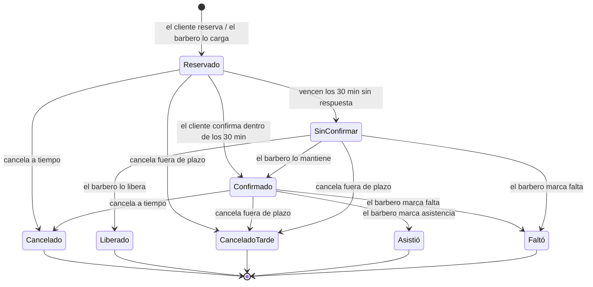

# Análisis inicial — Turnos para barbería (barber-colo)

Estado: aprobado (2026-11-20)
Fecha: 2026-11-20

> Documento previo a la constitución y a las specs. Define el problema, los actores, las reglas de
> negocio y los requisitos a nivel producto. De acá salen las specs `specs/NNN-*/` del flujo SDD.
> La tecnología se decide después (en la constitución y en cada `plan.md`).
>
> Continúa en: [modelo de dominio](dominio.md) · [casos de uso](casos-de-uso.md) · [diagramas de secuencia](secuencias.md) · [estadísticas y CRM](estadisticas-crm.md).

---

## 1. Problema

Hoy el barbero coordina todos los turnos por WhatsApp y los anota a mano en una libreta.

| Dolor | Consecuencia |
|---|---|
| Cada turno es una conversación de WhatsApp | Tiempo perdido respondiendo mientras corta; mensajes que se pierden. |
| La agenda está en papel | No se puede consultar fuera del local, hay riesgo de doble reserva y no hay historial. |
| No hay recordatorios | Los clientes se olvidan y faltan. |
| Las faltas no se registran | Un cliente puede faltar 3 veces seguidas sin consecuencia y el horario queda perdido. |
| No hay incentivo de fidelidad | No se premia al cliente que viene seguido. |

## 2. Objetivo

Una aplicación web instalable en el celular (PWA, con manifest y notificaciones push) donde:

- **El cliente** reserva, confirma o cancela su turno solo, sin escribirle al barbero, ve los precios y su progreso de beneficios.
- **El barbero** ve su agenda en tiempo real, recibe avisos, decide qué hacer con los turnos sin confirmar, registra la asistencia y aplica una política contra las faltas.

**Indicadores de éxito** (para medir después del lanzamiento):
- Menos turnos coordinados por WhatsApp (objetivo: menos del 20 % a los 2 meses).
- Menos faltas sin aviso respecto al mes anterior al lanzamiento.
- Porcentaje de turnos confirmados dentro del plazo.

## 3. Alcance de la primera versión

- **Un solo barbero**, una sola agenda, un solo local.
- **Todos los turnos duran lo mismo** (bloque fijo configurable, por ejemplo 30 min) y tienen **un precio** que carga el barbero.
- El cliente entra con **su cuenta de Google**.
- El barbero puede **cargar turnos a mano** y compartirle al cliente un enlace por WhatsApp.

## 4. Actores

| Actor | Descripción |
|---|---|
| **Cliente** | Persona con cuenta de Google que reserva y gestiona sus turnos. |
| **Cliente sin cuenta** | Persona que el barbero carga a mano (nombre y teléfono). Gestiona su turno con un enlace y se puede vincular a una cuenta más adelante. |
| **Barbero** (administrador) | Único usuario con permisos para configurar la agenda, los precios y los descuentos, ver todos los turnos, marcar asistencia y gestionar clientes. |
| **Sistema** (procesos automáticos) | Envía los pedidos de confirmación, avisa al barbero de los turnos sin confirmar y recalcula faltas y beneficios. |

## 5. Ciclo de vida de un turno

> **Versión vigente:** el diagrama actualizado (con PendienteAprobación y Rechazado) está en
> [`docs/dominio.md`](dominio.md#6-ciclo-de-vida-del-turno-actualizado). Este queda como referencia del análisis inicial.

- Solo **Asistió** suma para los beneficios y pone en cero las faltas seguidas.
- Solo **Faltó** suma para la política de faltas. **CanceladoTarde** queda registrado, sin penalización.

### Línea de tiempo de un turno (ejemplo: turno a las 18:00)

| Hora | Qué pasa |
|---|---|
| día anterior, 20:00 | Recordatorio simple con la opción de cancelar (sin pedir confirmación). |
| hasta las 14:00 | El cliente puede cancelar sin que quede registrado como tarde (plazo [4 h]). |
| 17:00 | El sistema le pide al cliente que confirme (a [1 h] del turno). |
| 17:00 – 17:30 | El cliente tiene [30 min] para confirmar o cancelar. |
| 17:30 | Si no respondió, el turno pasa a **SinConfirmar** y se avisa al barbero para que decida. |
| 18:00 | Turno. Después, el barbero marca Asistió o Faltó. |

## 6. Reglas de negocio

Los valores entre corchetes son **parámetros configurables por el barbero**; el número es el valor inicial.

### 6.1 Agenda y precios
- RN-01. El barbero define los días y horarios en que atiende, y la duración del bloque [30 min].
- RN-02. El barbero puede bloquear días u horarios puntuales (vacaciones, trámites).
- RN-03. Un horario admite como máximo un turno activo. No puede haber dos reservas en el mismo bloque.
- RN-04. No se puede reservar en el pasado ni con más de [30] días de anticipación.
- RN-05. Un cliente puede tener como máximo [1] turno futuro activo a la vez.
- RN-06. El barbero carga el precio del corte. La app muestra siempre el precio, el descuento que corresponde y el precio final.
- RN-06b. El **precio base queda congelado al reservar**: si el barbero lo cambia después, el turno conserva el precio que vio el cliente. Los descuentos sí se calculan al marcar Asistió, porque dependen de las asistencias anteriores; hasta entonces la app los muestra como **estimados**.

### 6.2 Confirmación y cancelación
- RN-07. [1 h] antes del turno, el sistema le pide al cliente que lo confirme.
- RN-08. El cliente tiene [30 min] desde ese pedido para confirmar o cancelar.
- RN-09. Si no responde en ese plazo, el turno pasa a **SinConfirmar** y el sistema avisa al barbero. El barbero decide si lo **mantiene** o lo **libera**; el sistema nunca lo libera solo.
- RN-10. El cliente puede cancelar sin que quede registrado como tarde hasta [4 h] antes del turno.
- RN-11. Una cancelación con menos de [4 h] queda registrada como **cancelación tarde**. No suma faltas ni tiene otra consecuencia; solo se ve en el historial.

### 6.3 Política de faltas
- RN-12. Después de cada turno, el barbero marca **Asistió** o **Faltó**. Mientras no lo marque, el turno queda pendiente de marcar.
- RN-13. El sistema cuenta las **faltas seguidas** de cada cliente: los turnos marcados como Faltó sin ninguna asistencia en el medio.
- RN-14. El contador **vuelve a cero** en cuanto el cliente tiene un turno marcado como Asistió. Las cancelaciones (a tiempo o tarde) no lo cambian.
- RN-15. Con [1 o 2] faltas seguidas: se le avisa al cliente cuál es la política, sin otra consecuencia.
- RN-16. Con [3] faltas seguidas: el cliente necesita **seña** para reservar. Mientras no exista la seña online (spec 009), sus reservas quedan **pendientes de aprobación del barbero**, que las acepta o las rechaza.
- RN-17. El barbero puede **bloquear** o **desbloquear** a un cliente a mano en cualquier momento.

### 6.4 Fidelización
- RN-18. **Visitas del mes**: el **4.º corte** de un cliente dentro de un mismo mes calendario tiene [10 %] de descuento. El conteo vuelve a cero el primer día de cada mes.
- RN-19. **Corte número N**: el corte número [10] (contando desde siempre) tiene [15 %] de descuento. Después, el contador vuelve a empezar.
- RN-20. Solo cuentan los turnos en estado **Asistió**.
- RN-21. Si en un mismo corte aplican varios descuentos, **se suman** (ejemplo: 10 % + 15 % = 25 % sobre el precio). Por ahora no hay tope.
- RN-22. El barbero carga y edita los porcentajes y las condiciones de cada beneficio.
- RN-23. El cliente ve una **barra de progreso** para cada beneficio ("3 de 4 cortes este mes", "7 de 10 cortes").
- RN-24. El cobro se hace en el local; la app no procesa el pago del corte.

### 6.5 Turnos cargados a mano
- RN-25. Al cargar un turno a mano, el sistema genera un **enlace al turno** que el barbero puede mandar por WhatsApp con un mensaje ya escrito (día, hora, precio y enlace).
- RN-26. Ese enlace abre una página del turno, sin necesidad de cuenta, donde la persona puede ver el turno y confirmarlo o cancelarlo, con los mismos plazos que en las reglas 6.2.
- RN-27. El enlace es secreto y no se puede adivinar; deja de servir cuando el turno termina o se cancela.

### 6.6 Recordatorio del día anterior y reservas con poca anticipación
- RN-28. El día anterior al turno, a una hora configurable [20:00], el sistema envía un **recordatorio simple** con día, hora, precio y la opción de cancelar. No pide confirmación.
- RN-29. Si el turno se reserva **después** de la hora de ese recordatorio (por ejemplo, a las 22:00 para el día siguiente, o para el mismo día), no se envía el recordatorio del día anterior: el aviso de reserva confirmada cumple esa función.
- RN-30. Se puede reservar para el mismo día con una anticipación mínima de [30 min], para que el barbero no se entere de un turno cuando el cliente ya está llegando.
- RN-31. Si el turno se reserva con **menos de [1 h]** de anticipación (el momento del pedido de confirmación ya pasó), el turno **nace Confirmado**: reservar en ese momento ya es la confirmación.
- RN-32. Si el turno se reserva entre [1 h] y [1 h 30 min] antes, el pedido de confirmación se envía en su horario normal, aunque llegue pocos minutos después de reservar.
- RN-33. Si se reserva con menos de [4 h] de anticipación, el cliente queda fuera del plazo de cancelación desde el inicio. Para corregir errores al reservar, cancelar dentro de los [10 min] siguientes a la reserva no queda registrado como cancelación tarde.
- RN-34. Estas mismas reglas valen para los turnos cargados a mano: el recordatorio y el pedido de confirmación de esos turnos se muestran en la página del enlace, y el barbero ve en el turno si ya está confirmado.

## 7. Requisitos funcionales (nivel producto)

> Formato EARS. Al pasar a cada spec se detallan los criterios de aceptación y los casos límite.

### Acceso y perfil
- RF-01. CUANDO un visitante elige "Ingresar con Google", EL SISTEMA crea su cuenta de cliente (si no existe) e inicia la sesión.
- RF-02. CUANDO un cliente entra por primera vez, EL SISTEMA le pide un teléfono de contacto y el permiso de notificaciones.
- RF-03. EL SISTEMA reconoce como barbero solo a la cuenta configurada como administradora.

### Agenda y precios (barbero)
- RF-04. CUANDO el barbero guarda su horario semanal y la duración del bloque, EL SISTEMA genera los horarios disponibles a partir de esos datos.
- RF-05. CUANDO el barbero bloquea un día u horario, EL SISTEMA deja de ofrecerlo y avisa a los clientes que ya tenían turno en ese rango.
- RF-06. EL SISTEMA muestra al barbero la agenda del día y de la semana, con el estado de cada turno.
- RF-07. CUANDO el barbero cambia el precio del corte, EL SISTEMA muestra el nuevo precio en los horarios que se ofrezcan desde ese momento.

### Reservas (cliente)
- RF-08. CUANDO un cliente elige un día, EL SISTEMA muestra solo los horarios libres de ese día, con el precio, el descuento que le correspondería y el precio final.
- RF-09. CUANDO un cliente reserva un horario libre, EL SISTEMA crea el turno en estado Reservado y notifica al barbero.
- RF-10. SI dos clientes intentan reservar el mismo horario, ENTONCES EL SISTEMA confirma solo la primera reserva y a la segunda le informa que el horario ya no está disponible.
- RF-11. SI el cliente ya tiene un turno futuro activo, ENTONCES EL SISTEMA no le permite reservar otro y le muestra el que tiene.
- RF-12. CUANDO un cliente cancela con 4 h o más de anticipación, EL SISTEMA libera el horario y notifica al barbero.
- RF-13. SI un cliente cancela con menos de 4 h de anticipación, ENTONCES EL SISTEMA le advierte que quedará registrado como cancelación tarde, y con su confirmación libera el horario, lo registra y notifica al barbero.

### Turnos manuales (barbero)
- RF-14. CUANDO el barbero carga un turno a mano con nombre y teléfono, EL SISTEMA lo crea en ese horario y genera el enlace secreto del turno.
- RF-15. CUANDO el barbero elige "Enviar por WhatsApp", EL SISTEMA abre WhatsApp con el número del cliente y un mensaje ya escrito con el día, la hora, el precio y el enlace.
- RF-16. CUANDO alguien abre un enlace de turno válido, EL SISTEMA muestra el turno y permite confirmarlo o cancelarlo con los mismos plazos que un turno reservado desde la app.
- RF-17. SI el enlace no existe, venció o el turno ya terminó, ENTONCES EL SISTEMA muestra un mensaje de enlace no válido, sin datos del turno.
- RF-18. CUANDO un cliente se registra con un teléfono que coincide con uno cargado a mano, EL SISTEMA le propone al barbero vincular el historial.

### Confirmación
- RF-19. CUANDO falta 1 h para un turno Reservado, EL SISTEMA le envía al cliente una notificación con las acciones Confirmar y Cancelar.
- RF-20. CUANDO el cliente confirma dentro de los 30 min, EL SISTEMA pasa el turno a Confirmado y notifica al barbero.
- RF-21. SI pasan 30 min desde el pedido sin respuesta, ENTONCES EL SISTEMA pasa el turno a SinConfirmar y notifica al barbero con las acciones Mantener y Liberar.
- RF-22. CUANDO el barbero libera un turno SinConfirmar, EL SISTEMA deja el horario libre y le avisa al cliente.
- RF-23. EL SISTEMA envía al barbero un resumen de los turnos del día a una hora configurable [8:00].

### Asistencia y faltas
- RF-24. CUANDO el barbero marca un turno como Faltó, EL SISTEMA suma una falta seguida al cliente y le notifica según la política vigente.
- RF-25. CUANDO el barbero marca un turno como Asistió, EL SISTEMA pone en cero las faltas seguidas del cliente.
- RF-26. MIENTRAS un cliente tenga 3 faltas seguidas o más, EL SISTEMA deja sus reservas pendientes de aprobación del barbero y se lo informa al reservar.
- RF-27. MIENTRAS un cliente esté bloqueado, EL SISTEMA no le permite reservar y le indica que se comunique con el barbero.
- RF-28. EL SISTEMA muestra al barbero el historial de cada cliente: asistencias, faltas, cancelaciones tarde y faltas seguidas actuales.

### Fidelización
- RF-29. CUANDO un turno pasa a Asistió, EL SISTEMA actualiza el progreso de beneficios del cliente.
- RF-30. CUANDO el próximo corte de un cliente cumple la condición de uno o más beneficios, EL SISTEMA se lo notifica y muestra en el turno la suma de los descuentos y el precio final.
- RF-31. CUANDO empieza un mes nuevo, EL SISTEMA pone en cero el progreso de "visitas del mes" de todos los clientes.
- RF-32. EL SISTEMA muestra al cliente una barra de progreso por cada beneficio activo.
- RF-33. CUANDO el barbero crea, edita o desactiva un beneficio, EL SISTEMA lo aplica desde ese momento sin modificar los descuentos de turnos ya terminados.

### Recordatorio y reservas con poca anticipación
- RF-35. CUANDO llega la hora del recordatorio [20:00] del día anterior a un turno activo que se reservó antes de esa hora, EL SISTEMA le envía al cliente un recordatorio con la opción de cancelar.
- RF-36. SI un turno se reserva después de la hora del recordatorio del día anterior, ENTONCES EL SISTEMA no envía ese recordatorio.
- RF-37. SI un cliente intenta reservar con menos de [30 min] de anticipación, ENTONCES EL SISTEMA no ofrece ese horario.
- RF-38. CUANDO un cliente reserva con menos de 1 h de anticipación, EL SISTEMA crea el turno directamente en estado Confirmado y no envía pedido de confirmación.
- RF-39. CUANDO un cliente cancela dentro de los [10 min] siguientes a reservar, EL SISTEMA libera el horario sin registrarlo como cancelación tarde, aunque falten menos de 4 h.
- RF-40. CUANDO el barbero cambia el precio del corte, EL SISTEMA mantiene en los turnos ya reservados el precio base que tenían al reservar.

### Notificaciones
- RF-34. SI el usuario no dio permiso de notificaciones, ENTONCES EL SISTEMA muestra los avisos pendientes dentro de la app y le recuerda cómo activarlas.

## 8. Requisitos no funcionales

| Id | Categoría | Requisito |
|---|---|---|
| RNF-01 | Plataforma | Aplicación web instalable (PWA con manifest y service worker), mobile-first, usable en celulares desde 360 px de ancho. |
| RNF-02 | Notificaciones | Web Push en Android (Chrome) y en iOS 16.4 o posterior. En iOS el push solo funciona si la app está **agregada a la pantalla de inicio**: la app debe explicarlo con instrucciones. |
| RNF-03 | Puntualidad | Con una ventana de confirmación de 30 min, el pedido de confirmación y el aviso de SinConfirmar deben salir con un desfase máximo de 2 min respecto de la hora prevista. |
| RNF-04 | Fechas | Todas las fechas y horas se calculan en la zona horaria del local (`America/Argentina/Buenos_Aires`). El "mes" de los beneficios es el mes calendario en esa zona. |
| RNF-05 | Concurrencia | Es imposible que existan dos turnos activos en el mismo horario. Lo garantiza el servidor, no la interfaz. |
| RNF-06 | Seguridad | Login con Google (OAuth). Toda acción del barbero se valida en el servidor por rol. Un cliente solo puede ver y modificar sus propios turnos. Los enlaces de turno usan tokens aleatorios largos y solo dan acceso a ese turno. |
| RNF-07 | Privacidad | Se guardan solo los datos mínimos (nombre, email, teléfono e historial de turnos). Se cumple la Ley 25.326 de Protección de Datos Personales: el cliente puede pedir que se borren sus datos. La página del enlace no muestra el teléfono ni el historial. |
| RNF-08 | Montos | Precios y descuentos se calculan sin errores de redondeo (enteros en centavos o decimales exactos). El turno guarda el precio, el descuento y el precio final que se le mostraron al cliente. |
| RNF-09 | Rendimiento | La agenda del día carga en menos de 2 s con conexión 4G. |
| RNF-10 | Disponibilidad | Si las notificaciones fallan, la app sigue funcionando; los avisos no enviados quedan registrados y se muestran dentro de la app. |
| RNF-11 | Costo | Debe poder funcionar en planes gratuitos o de muy bajo costo, porque es un solo barbero. |
| RNF-12 | Usabilidad | Reservar un turno no debe llevar más de 3 toques desde la pantalla principal. Confirmar debe poder hacerse desde la propia notificación. Interfaz en español rioplatense. |
| RNF-13 | Auditoría | Cada cambio de estado de un turno guarda quién lo hizo y cuándo (para resolver reclamos de faltas). |
| RNF-14 | Calidad | La lógica de negocio (disponibilidad, plazos, faltas, beneficios y precios) son funciones puras con tests automáticos que reciben "ahora" como parámetro. |

## 9. Fuera de alcance de la primera versión

- Varios barberos o varias sucursales.
- Servicios con duraciones o precios distintos.
- Cobro online del corte. La **seña online** (por ejemplo, con Mercado Pago) queda para la spec 009.
- Envío automático de mensajes por WhatsApp (bot o API). En v1 el barbero comparte el enlace a mano con un mensaje ya escrito.
- Lista de espera cuando se libera un turno.
- Tope máximo de descuento acumulado.
- Estadísticas avanzadas o reportes de facturación.

## 10. Backlog de specs (orden propuesto)

| # | Spec | Contenido | RF | MVP |
|---|---|---|---|---|
| 001 | `agenda-disponibilidad` | Horario semanal, bloque fijo, bloqueos, precio, anticipación mínima y cálculo de horarios libres | 04–07, 37 | ✅ |
| 002 | `login-perfil` | Google, alta de cliente, teléfono, rol barbero | 01–03 | ✅ |
| 003 | `reserva-cancelacion` | Reservar, evitar doble reserva, cancelar y **reprogramar** en plazo o tarde, margen de 10 min, precio congelado, cancelación del barbero con motivo | 08–13, 39–40, P-05, P-07, P-14 | ✅ |
| 004 | `turnos-manuales-enlace` | Carga manual, enlace secreto, mensaje para WhatsApp y vinculación de clientes | 14–18 | ✅ |
| 005 | `pwa-notificaciones` | Manifest, instalación, permisos, Web Push con acciones y avisos dentro de la app | 34 + avisos de las demás | ✅ |
| 006 | `confirmacion` | Recordatorio del día anterior, pedido 1 h antes, ventana de 30 min, SinConfirmar, reservas con poca anticipación y resumen diario | 19–23, 35–39 | ✅ |
| 007 | `asistencia-faltas` | Marcar asistencia, faltas seguidas, aprobación, bloqueo e historial | 24–28 | ✅ |
| 008 | `fidelizacion` | Descuento del 4.º corte del mes, del corte 10 y de cumpleaños, suma de descuentos y barras de progreso | 29–33, P-15 | v1.1 |
| 009 | `sena-online` | Seña con Mercado Pago para clientes con 3 faltas seguidas | — | v2 |
| 010 | `estadisticas-crm` | Indicadores por período, ficha 360, salud del cliente y "a quién escribirle hoy" (ver `docs/estadisticas-crm.md`) | P-10 a P-13 | v1.1 |

> La 001 va primero porque toda la lógica de turnos depende de calcular bien los horarios libres, y es
> la parte con más riesgo de errores de fechas (como pasaba con la racha en el Diario de Estudio).

## 11. Propuesta de constitución (borrador, se cierra al elegir la tecnología)

1. **La spec manda**: nada se implementa si no está en la spec activa. Si falta una decisión, se para y se pregunta.
2. **Lógica separada de la interfaz**: disponibilidad, plazos, faltas, beneficios y precios son funciones puras que reciben "ahora" como parámetro, sin acceso a la base de datos ni a la UI.
3. **Tests como puerta**: no se avanza con tests en rojo. Cada RF tiene al menos un test o una verificación manual documentada.
4. **El servidor es la fuente de verdad**: permisos, unicidad de turnos, plazos y reglas de negocio se validan en el servidor, nunca solo en el cliente.
5. **Fechas siempre en la zona horaria del local**: nunca se calcula un día con UTC ni sumando milisegundos.
6. **Los datos del cliente son mínimos y suyos**: solo lo necesario, con borrado a pedido y sin datos sensibles en logs.
7. **Mobile-first y simple**: cada pantalla se diseña primero para el celular; no se agregan dependencias sin justificarlo en el plan.
8. **Idioma**: código en inglés; interfaz y documentación en español.

## 12. Decisiones tomadas

| Id | Decisión |
|---|---|
| D-01 | El sistema pide la confirmación 1 h antes y el cliente tiene 30 min para responder. Si no responde, se avisa al barbero, que decide si mantiene o libera el turno. |
| D-02 | La cancelación tarde solo queda registrada; no suma faltas. |
| D-03 | Las faltas que cuentan son las **seguidas**. El contador vuelve a cero cuando el cliente asiste. |
| D-04 | El descuento por visitas se aplica en el **4.º corte del mismo mes** y el conteo se reinicia cada mes. |
| D-05 | Por ahora los descuentos se **suman**. |
| D-06 | La app muestra el precio, el descuento y el precio final. El barbero carga los precios y los descuentos. |
| D-07 | Los turnos cargados a mano incluyen un enlace al turno para compartir por WhatsApp. |

| D-08 | Se agrega un recordatorio simple el día anterior. Hay que contemplar las reservas para el mismo día (ver 6.6). |
| D-09 | Se respeta el precio que vio el cliente al reservar. |

### Casos borde de las reservas para el mismo día

Ejemplos con un turno a las 16:00 (recordatorio [20:00], confirmación [1 h] antes, cancelación sin registro hasta [4 h] antes):

| Reserva hecha | Recordatorio del día anterior | Pedido de confirmación | ¿Puede cancelar sin registro? | Regla |
|---|---|---|---|---|
| Ayer a las 18:00 | Sí, ayer a las 20:00 | Hoy 15:00 (ventana hasta 15:30) | Hasta hoy a las 12:00 | Caso normal |
| Ayer a las 22:00 | No (ya pasó la hora) | Hoy 15:00 | Hasta hoy a las 12:00 | RN-29 |
| Hoy a las 10:00 | No | Hoy 15:00 | Hasta las 12:00 | RN-29 |
| Hoy a las 13:00 | No | Hoy 15:00 | Solo hasta las 13:10 | RN-33 |
| Hoy a las 14:45 | No | Hoy 15:00, normal | Solo hasta las 14:55 | RN-32, RN-33 |
| Hoy a las 15:10 | No | No; nace Confirmado | Solo hasta las 15:20 | RN-31, RN-33 |
| Hoy a las 15:40 | — | — | — | No se ofrece el horario (RN-30) |

Otros casos a cubrir en los tests:
- Un turno del 1.º del mes reservado a fin del mes anterior: el "4.º corte del mes" se cuenta según el **mes del turno**, no el de la reserva.
- El primer turno del día (por ejemplo, 9:00): el pedido de confirmación sale a las 8:00, aunque el local abra más tarde.
- El recordatorio de un turno de lunes sale el domingo, aunque el local no abra ese día.
- El barbero bloquea un horario que ya tenía un turno reservado para el mismo día: se aplica RF-05 (aviso al cliente) en el momento.

## 13. Propuestas aprobadas

- P-01. **Anticipación mínima de 30 min** para reservar (RN-30). ✅
- P-02. **10 min de margen** después de reservar para cancelar sin que quede registrado como tarde (RN-33). ✅
- P-03. **Recordatorio del día anterior a las 20:00**, configurable por el barbero (RN-28). ✅
