# Casos de uso — barber-colo

Estado: aprobado (2026-11-20)
Origen: [`docs/analisis.md`](analisis.md) · Modelo: [`docs/dominio.md`](dominio.md)

> Cada caso de uso es algo que un actor quiere lograr con el sistema. Se agrupan por módulo dueño para
> que cada spec SDD tome un grupo cohesivo. Los marcados con ★ están detallados en la sección 3.

---

## 1. Actores

| Actor | Quién es |
|---|---|
| **Cliente** | Persona con cuenta de Google. |
| **Invitado** | Persona sin cuenta que abre un enlace de turno. |
| **Barbero** | Administrador único. |
| **Reloj** | Disparador del sistema que corre cada minuto (actor secundario, sin persona detrás). |

## 2. Catálogo

### Diagrama general

```mermaid
flowchart LR
    Cliente([👤 Cliente])
    Invitado([👤 Invitado])
    Barbero([✂️ Barbero])
    Reloj([⏱ Reloj])

    subgraph Sistema barber-colo
        direction TB
        CU01[CU-01 Ingresar y completar perfil]
        CU02[CU-02 Consultar horarios libres]
        CU03[CU-03 Reservar turno ★]
        CU04[CU-04 Confirmar turno ★]
        CU05[CU-05 Cancelar turno ★]
        CU06[CU-06 Ver mis turnos y beneficios]
        CU07[CU-07 Activar notificaciones]
        CU08[CU-08 Pedir baja de datos]
        CU09[CU-09 Gestionar turno por enlace ★]

        CU10[CU-10 Configurar agenda]
        CU11[CU-11 Bloquear días u horarios]
        CU12[CU-12 Configurar precio y beneficios]
        CU13[CU-13 Configurar plazos]
        CU14[CU-14 Ver agenda]
        CU15[CU-15 Cargar turno manual ★]
        CU16[CU-16 Aprobar o rechazar reserva ★]
        CU17[CU-17 Decidir turno sin confirmar ★]
        CU18[CU-18 Registrar asistencia o falta ★]
        CU19[CU-19 Cancelar turno como barbero]
        CU30[CU-30 Reprogramar turno ★]
        CU20[CU-20 Ver ficha y bloquear cliente]
        CU21[CU-21 Vincular cliente]

        CU22[CU-22 Procesar plazos de turnos ★]
        CU23[CU-23 Entregar notificaciones]
        CU24[CU-24 Enviar resumen diario]
        CU25[CU-25 Inicio del día]
        CU26[CU-26 Indicadores]
        CU27[CU-27 Ficha 360]
        CU28[CU-28 Escribir a quien se enfría]
    end

    Cliente --- CU30 & CU01 & CU02 & CU03 & CU04 & CU05 & CU06 & CU07 & CU08
    Invitado --- CU09
    Barbero --- CU10 & CU11 & CU12 & CU13 & CU14 & CU15 & CU16 & CU17 & CU18 & CU19 & CU30 & CU20 & CU21 & CU07 & CU25 & CU26 & CU27 & CU28
    Reloj --- CU22 & CU23 & CU24
```

### Tabla por módulo

| CU | Nombre | Actor | Módulo dueño | RF / RN | Spec |
|---|---|---|---|---|---|
| CU-01 | Ingresar con Google y completar perfil | Cliente | Identidad + Clientes | RF-01 a 03 | 002 |
| CU-02 | Consultar horarios libres | Cliente | Agenda + Turnos | RF-07, 08, 37 | 001 |
| CU-03 ★ | Reservar turno | Cliente | Turnos | RF-08 a 11, 26, 27, 38, 40 | 003 |
| CU-04 ★ | Confirmar turno | Cliente | Turnos | RF-20 | 006 |
| CU-05 ★ | Cancelar turno | Cliente | Turnos | RF-12, 13, 39 | 003 |
| CU-06 | Ver mis turnos y progreso de beneficios | Cliente | Turnos + Precios | RF-24, 32 | 003, 008 |
| CU-07 | Activar notificaciones e instalar la app | Cliente, Barbero | Notificaciones | RF-02, 34, RNF-02 | 005 |
| CU-08 | Pedir la baja de mis datos | Cliente | Clientes | RNF-07 | 002 |
| CU-09 ★ | Gestionar turno por enlace | Invitado | Turnos | RF-16, 17 | 004 |
| CU-10 | Configurar agenda (franjas, bloque, anticipación) | Barbero | Agenda | RF-04, RN-01, 04, 30 | 001 |
| CU-11 | Bloquear días u horarios | Barbero | Agenda | RF-05, RN-02 | 001 |
| CU-12 | Configurar precio y beneficios | Barbero | Precios | RF-07, 33, RN-22 | 001, 008 |
| CU-13 | Configurar plazos (cancelación, confirmación, recordatorio) | Barbero | Turnos | RN-07 a 11, 28 | 006 |
| CU-14 | Ver agenda del día y de la semana | Barbero | Turnos + Agenda | RF-06 | 003 |
| CU-15 ★ | Cargar turno manual y compartir enlace | Barbero | Turnos + Clientes | RF-14, 15, P-08 | 004 |
| CU-16 ★ | Aprobar o rechazar reserva pendiente | Barbero | Turnos | RF-26, P-04 | 007 |
| CU-17 ★ | Decidir turno sin confirmar | Barbero | Turnos | RF-21, 22 | 006 |
| CU-18 ★ | Registrar asistencia o falta | Barbero | Turnos | RF-24, 25, 29, 30, P-06, P-09 | 007, 008 |
| CU-19 | Cancelar turno como barbero (con motivo) | Barbero | Turnos | P-05 | 003 |
| CU-30 ★ | Reprogramar turno | Cliente, Barbero, Invitado | Turnos | P-07, P-14 | 003 |
| CU-20 | Ver ficha del cliente y bloquearlo | Barbero | Conducta + Clientes | RF-27, 28, RN-17 | 007 |
| CU-21 | Vincular cliente sin cuenta | Barbero | Clientes | RF-18 | 004 |
| CU-22 ★ | Procesar plazos de turnos | Reloj | Turnos | RF-19, 21, 35, 36, P-04 | 006 |
| CU-23 | Entregar notificaciones (con reintentos) | Reloj | Notificaciones | RNF-03, 10 | 005 |
| CU-24 | Enviar resumen diario al barbero | Reloj | Notificaciones | RF-23 | 006 |
| CU-25 | Ver el inicio del día | Barbero | Estadísticas | P-10 | 007 |
| CU-26 | Ver indicadores por período | Barbero | Estadísticas | P-10 | 010 |
| CU-27 | Ver ficha 360 del cliente y editar notas | Barbero | Estadísticas + Clientes | P-10 | 010 |
| CU-28 | Escribirle a un cliente que se enfría | Barbero | Clientes | P-13 | 010 |
| CU-29 | Configurar listas (cómo nos conoció, motivos de cancelación) | Barbero | Clientes + Turnos | P-10 | 010 |

> CU-25 a CU-29 se detallan en [`estadisticas-crm.md`](estadisticas-crm.md).

## 3. Casos de uso detallados

### CU-03 ★ Reservar turno

| | |
|---|---|
| **Actor** | Cliente |
| **Precondiciones** | Sesión iniciada con perfil completo (teléfono cargado). |
| **Garantía de éxito** | Existe un turno activo del cliente en ese horario, con el precio base congelado, y el barbero fue avisado. |

**Flujo principal**
1. El cliente elige un día.
2. El sistema muestra los horarios libres con precio, descuento estimado y precio final.
3. El cliente elige un horario y confirma la reserva.
4. El sistema verifica la habilitación del cliente (normal).
5. El sistema verifica que el horario siga libre y que el cliente no tenga otro turno futuro activo.
6. El sistema crea el turno con la tarifa vigente como precio base y estado **Reservado**.
7. El sistema muestra la confirmación y avisa al barbero.

**Flujos alternativos**
- 4a. **Requiere aprobación** (3+ faltas seguidas): solo se le ofrecen horarios a 2 h o más (P-04); el turno se crea **PendienteAprobación**, se le explica al cliente que el barbero tiene que aprobarlo y se pide la decisión al barbero (→ CU-16).
- 4b. **Bloqueado**: el sistema no permite reservar y le indica que se comunique con el barbero.
- 5a. **Otro cliente tomó el horario** entre los pasos 2 y 5: el sistema informa que ya no está disponible y vuelve al paso 2.
- 5b. **Ya tiene un turno futuro activo**: el sistema lo muestra y no permite reservar otro.
- 6a. **Falta menos de 1 h**: el turno nace **Confirmado** (RN-31).
- 6b. **La reserva es posterior a las 20:00 del día anterior**: no se programará recordatorio del día anterior (RN-29).

---

### CU-05 ★ Cancelar turno

| | |
|---|---|
| **Actor** | Cliente |
| **Precondiciones** | El cliente tiene un turno activo que todavía no empezó. |
| **Garantía de éxito** | El horario queda libre; si fue tarde, queda registrado; el barbero fue avisado. |

**Flujo principal**
1. El cliente elige "Cancelar" en su turno (desde la app o desde una notificación).
2. El sistema determina el tipo: **a tiempo** (faltan 4 h o más, o está dentro de los 10 min posteriores a reservar).
3. El sistema pide confirmar la cancelación.
4. El sistema pasa el turno a **Cancelado**, libera el horario y avisa al barbero.

**Flujos alternativos**
- 2a. **Tarde** (faltan menos de 4 h y pasaron más de 10 min desde la reserva): en el paso 3 el sistema advierte que quedará registrado como cancelación tarde; en el paso 4 el estado es **CanceladoTarde** y Conducta lo registra (sin sumar faltas).
- 1a. **El turno ya empezó**: no se puede cancelar.

---

### CU-04 ★ Confirmar turno / CU-17 ★ Decidir turno sin confirmar / CU-22 ★ Procesar plazos

Estos tres casos son un mismo proceso visto por actores distintos. El **Reloj** dispara cada minuto
CU-22, que decide qué corresponde según la hora:

| Momento | Condición | Resultado |
|---|---|---|
| Día anterior, 20:00 | Turno activo reservado antes de esa hora | Recordatorio simple al cliente (RF-35) |
| 1 h antes | Turno **Reservado** | Pedido de confirmación con acciones Confirmar / Cancelar (RF-19) |
| 1 h antes | Turno **PendienteAprobación** | Rechazo automático y aviso al cliente (P-04) |
| 30 min después del pedido | Turno sigue **Reservado** | Pasa a **SinConfirmar**; se pide al barbero Mantener / Liberar (RF-21) |

**CU-04, flujo principal (Cliente):**
1. El cliente toca "Confirmar" en la notificación o en la app dentro de la ventana.
2. El sistema pasa el turno a **Confirmado** y avisa al barbero.

- 1a. **La ventana ya venció**: el sistema informa que el turno está esperando la decisión del barbero.

**CU-17, flujo principal (Barbero):**
1. El barbero recibe el aviso de turno sin confirmar.
2. Elige **Mantener**: el turno pasa a **Confirmado**.
   - 2a. Elige **Liberar**: el turno pasa a **Liberado**, el horario queda libre y se avisa al cliente.
   - 2b. No decide: el turno sigue **SinConfirmar** y ocupa el horario; después del turno puede marcarlo como Faltó.

**Idempotencia:** si el Reloj se demora o corre dos veces, cada acción se ejecuta una sola vez por turno
(cada turno guarda cuándo se envió su recordatorio y su pedido).

---

### CU-09 ★ Gestionar turno por enlace

| | |
|---|---|
| **Actor** | Invitado |
| **Precondiciones** | El barbero cargó el turno a mano y compartió el enlace (CU-15). |

**Flujo principal**
1. El invitado abre el enlace.
2. El sistema valida el enlace y muestra día, hora, precio y estado (sin teléfono ni historial).
3. El invitado elige Confirmar o Cancelar; aplican las mismas reglas que CU-04 y CU-05.
4. El sistema muestra una invitación opcional a crear su cuenta.

**Flujos alternativos**
- 2a. **Enlace inválido, vencido o turno terminado**: mensaje de enlace no válido, sin datos (RF-17).

---

### CU-15 ★ Cargar turno manual y compartir enlace

| | |
|---|---|
| **Actor** | Barbero |
| **Garantía de éxito** | Existe un turno activo con origen manual y un enlace secreto; WhatsApp quedó abierto con el mensaje. |

**Flujo principal**
1. El barbero elige un horario libre en su agenda.
2. Busca al cliente por nombre o teléfono y lo selecciona.
3. El sistema crea el turno (mismas reglas que CU-03: precio base, estado inicial según la hora) y genera el enlace.
4. El barbero toca "Enviar por WhatsApp"; el sistema abre WhatsApp con el número y un mensaje ya escrito.

**Flujos alternativos**
- 2a. **No existe**: el barbero carga nombre y teléfono y el sistema crea un cliente sin cuenta.
- 2b. **El teléfono ya existe con otro nombre**: el sistema muestra el cliente existente y pide elegir.
- 3a. **Cliente bloqueado o que requiere aprobación**: el sistema lo advierte; como lo carga el barbero, puede seguir (cuenta como aprobado).

---

### CU-16 ★ Aprobar o rechazar reserva pendiente

1. El barbero recibe el aviso con el cliente, el horario y sus faltas seguidas.
2. Elige **Aprobar**: el turno pasa a **Reservado** y sigue el ciclo normal; se avisa al cliente.
   - 2a. Elige **Rechazar**: el turno pasa a **Rechazado**, el horario queda libre y se avisa al cliente.
   - 2b. No decide antes de 1 h del turno: lo rechaza el Reloj (P-04).

---

### CU-18 ★ Registrar asistencia o falta

| | |
|---|---|
| **Actor** | Barbero |
| **Precondiciones** | El turno es Confirmado o SinConfirmar y ya empezó. |
| **Garantía de éxito** | El turno es Asistió (con liquidación) o Faltó; Conducta y Precios quedaron actualizados. |

**Flujo principal (asistió)**
1. El barbero abre el turno y ve el precio base, los descuentos que corresponden y el precio final.
2. Toca **Asistió**.
3. El sistema calcula la liquidación con las visitas computables previas del cliente y las reglas activas.
4. El turno pasa a **Asistió** con su liquidación.
5. Conducta pone en cero las faltas seguidas; Precios registra la visita computable.
6. Si con esta visita el cliente alcanza un beneficio para el próximo corte, se le avisa.

**Flujos alternativos**
- 2a. Toca **Faltó**: el turno pasa a **Faltó**; Conducta suma una falta seguida; si llega al umbral, se avisa al cliente de la política.
- 2b. **Corrección** dentro de las 48 h (P-06): el barbero cambia la marca; se revierte el efecto anterior y se aplica el nuevo, y queda en el historial.
- 1a. **SinConfirmar y el cliente vino**: puede marcar Asistió directamente (P-09).

---

### CU-19 Cancelar turno como barbero

1. El barbero elige "Cancelar" en un turno activo.
2. El sistema pide el **motivo** (obligatorio, texto corto; con sugerencias como "Me surgió un imprevisto").
3. El turno pasa a **Cancelado** (actor: barbero), el horario queda libre y el cliente recibe una notificación con el motivo y un enlace para reservar otro horario.
- 3a. Si el turno es manual, el barbero puede reenviar el aviso por WhatsApp con el mensaje ya escrito.

---

### CU-30 ★ Reprogramar turno

| | |
|---|---|
| **Actor** | Cliente, Invitado (por enlace) o Barbero |
| **Precondiciones** | Turno activo que no empezó; el cliente no superó las [2] reprogramaciones. |
| **Garantía de éxito** | El mismo turno está en el horario nuevo, con su precio base original, y la otra parte fue avisada. |

**Flujo principal (cliente)**
1. El cliente elige "Cambiar horario" en su turno.
2. El sistema le muestra los horarios libres (mismas reglas que CU-02) e indica si el cambio quedará como tarde.
3. El cliente elige el nuevo horario y confirma.
4. El sistema verifica que siga libre, mueve el turno y recalcula su estado (`initialStatus`): si estaba Confirmado, vuelve a Reservado y se reprograman el recordatorio y el pedido de confirmación.
5. El sistema le envía una notificación al barbero con el horario anterior, el nuevo y si fue tarde.

**Flujos alternativos**
- 2a. **Faltan menos de 4 h** (y pasaron más de 10 min desde la reserva): se advierte que quedará registrado como reprogramación tarde.
- 1a. **Ya reprogramó 2 veces**: el sistema ofrece cancelar.
- 4a. **El horario nuevo lo tomó otro cliente**: vuelve al paso 2; el turno sigue en su horario original.
- 1b. **Barbero**: elige el nuevo horario, escribe el motivo y el cliente recibe la notificación con el horario nuevo. No cuenta como tarde ni consume el límite del cliente.
