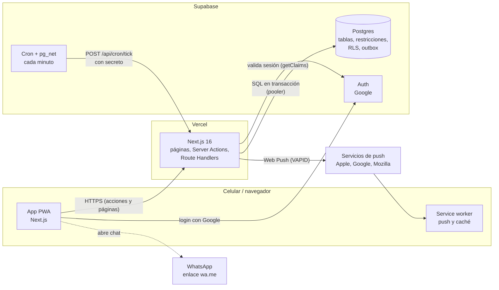
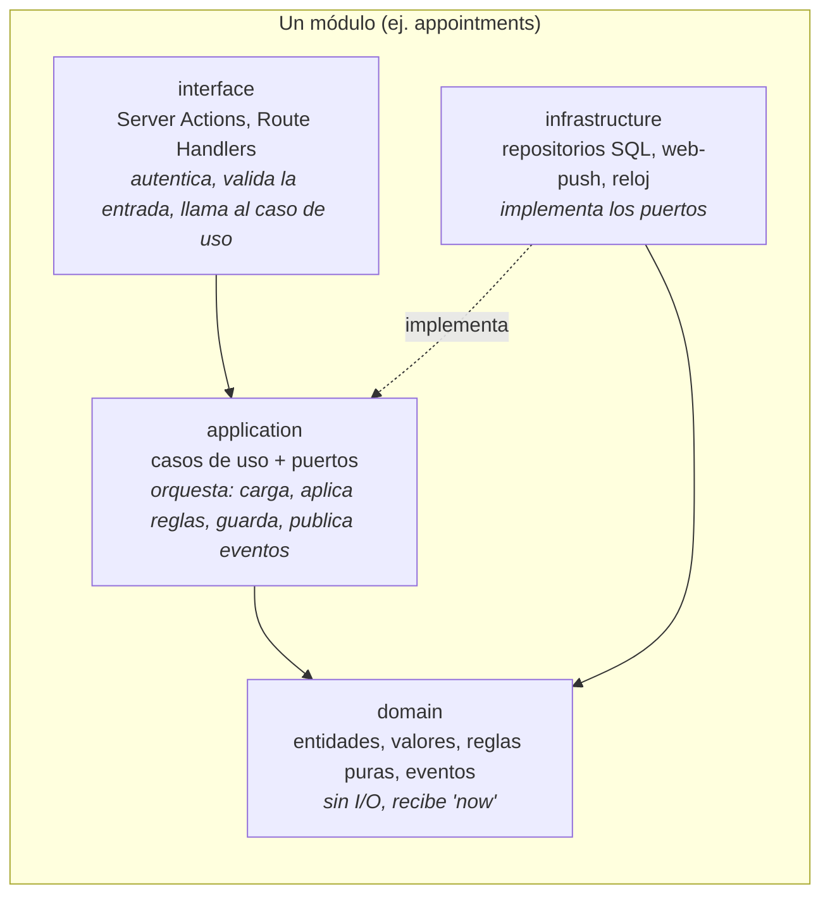
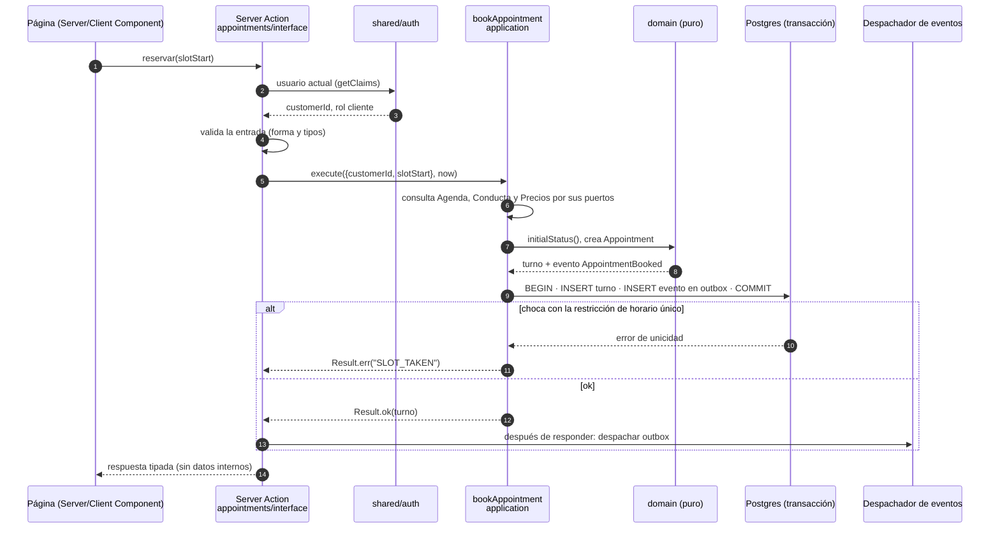

# Diseño 1 — Arquitectura de la aplicación

Estado: aprobado (2026-11-20)
Parte de: Diseño → **1. Arquitectura** · 2. Base de datos · 3. Backend · 4. Interfaz
Entrada: [`docs/dominio.md`](../dominio.md), [`docs/casos-de-uso.md`](../casos-de-uso.md), [`docs/constitution.md`](../constitution.md)

> Traduce el modelo de dominio (8 módulos, eventos, reglas puras) a una estructura de código y de
> despliegue. Cada decisión importante tiene su registro (ADR) con la alternativa descartada.

---

## 1. Vista general



**En una frase:** un monolito modular en Next.js, desplegado en Vercel, con Supabase como base de
datos, login y reloj. No hay un backend separado.

## 2. Estilo: monolito modular con arquitectura hexagonal por módulo

Cada uno de los 8 módulos del dominio es una carpeta con **cuatro capas**. Las dependencias apuntan
siempre hacia adentro: el dominio no conoce la base de datos ni Next.js.



| Capa | Contiene | Puede importar | No puede importar |
|---|---|---|---|
| `domain` | Agregados, objetos valor, servicios puros (`freeSlots`, `dueActions`, `settle`…), eventos | `shared/kernel` | Nada más: ni otras capas, ni otros módulos, ni librerías de I/O |
| `application` | Casos de uso (`bookAppointment`, `processDueActions`…) y **puertos** (interfaces de repositorios y de consultas a otros módulos) | su `domain`, `shared` | `infrastructure`, Next.js, la base |
| `infrastructure` | Repositorios con SQL, adaptadores de otros módulos, web-push | su `domain` y `application`, `shared`, librerías | `interface` |
| `interface` | Server Actions y Route Handlers del módulo | su `application`, `shared` | `infrastructure` directa (la recibe armada) |

**Entre módulos** solo se importa el archivo público `index.ts` de cada módulo (casos de uso, tipos de
eventos y consultas). Nunca sus carpetas internas. Así se cumple el bajo acoplamiento del modelo de
dominio en el código, no solo en el papel.

**Cómo se hace cumplir:** un test de arquitectura (Vitest, sin dependencias nuevas) recorre los
`import` de `src/` y falla si alguna capa o módulo rompe estas reglas. Corre en `npm test`, así que
el pre-commit y CI lo frenan.

## 3. Estructura de carpetas

```text
barber-colo-app/
├── src/
│   ├── app/                          # Rutas de Next.js (solo composición de UI)
│   │   ├── (cliente)/                # Reservar, mis turnos, perfil, beneficios
│   │   ├── (barbero)/                # Inicio, agenda, clientes, indicadores, ajustes
│   │   ├── t/[token]/                # Página del enlace de turno (invitado, sin cuenta)
│   │   ├── auth/callback/route.ts    # Vuelta del login con Google
│   │   ├── api/cron/tick/route.ts    # Llamado por Supabase Cron cada minuto
│   │   ├── manifest.ts               # Manifest de la PWA
│   │   └── layout.tsx
│   ├── modules/
│   │   ├── appointments/             # Turnos (núcleo)
│   │   │   ├── domain/
│   │   │   ├── application/
│   │   │   ├── infrastructure/
│   │   │   ├── interface/
│   │   │   └── index.ts              # API pública del módulo
│   │   ├── schedule/                 # Agenda
│   │   ├── customers/                # Clientes
│   │   ├── conduct/                  # Conducta
│   │   ├── pricing/                  # Precios y beneficios
│   │   ├── notifications/            # Notificaciones
│   │   ├── identity/                 # Identidad (sesión, rol)
│   │   └── stats/                    # Estadísticas (solo lectura)
│   ├── shared/
│   │   ├── kernel/                   # Money, Slot, LocalDate, Result, DomainEvent, Clock
│   │   ├── db/                       # Cliente SQL, transacción, outbox
│   │   ├── events/                   # Despachador de eventos
│   │   └── auth/                     # Capa de acceso: usuario actual y rol
│   ├── ui/                           # Sistema de diseño: componentes y gráficos propios
│   └── proxy.ts                      # Refresca la sesión de Supabase (Next 16)
├── public/sw.js                      # Service worker
├── supabase/
│   ├── migrations/                   # SQL versionado (tablas, índices, RLS, cron)
│   ├── seed.sql                      # Datos de prueba
│   └── config.toml
├── tests/
│   ├── architecture.test.ts          # Reglas de capas y módulos
│   ├── integration/                  # Contra un Postgres local de Supabase
│   └── e2e/                          # Playwright (etapa "Tests")
└── docs/
```

Los nombres de carpetas y código van en inglés (constitución, principio 10); la correspondencia con el
lenguaje ubicuo está en el glosario de [`dominio.md`](../dominio.md#3-lenguaje-ubicuo-glosario).

## 4. Cómo viaja una petición

Ejemplo: un cliente reserva un turno (secuencia S-1 del análisis, ahora con las piezas reales).



Reglas de esta capa, tomadas de la guía de seguridad de Next.js 16 que trae el paquete:
- **Cada Server Action es una entrada pública**: autentica, autoriza y valida aunque el formulario
  solo se muestre a quien corresponde.
- El cliente manda **identificadores y cambios**, nunca el contenido de una fila ni quién es el dueño:
  eso se deriva de la sesión.
- Lo que devuelve una acción es **la forma que necesita la pantalla**, no la fila de la base.
- Los errores de negocio viajan como valores (`Result`), no como excepciones.

## 5. Decisiones de arquitectura (ADR)

### ADR-01. Monolito en Next.js, sin backend separado

- **Decisión:** toda la lógica del servidor vive en Next.js (Server Actions para la interfaz, Route
  Handlers para el cron, el login y el enlace de turno).
- **Por qué:** un solo lenguaje (TypeScript) para dominio, servidor e interfaz; un solo despliegue;
  los tipos viajan de punta a punta; entra en planes gratuitos.
- **Descartado:** backend FastAPI aparte, como Corralap. Suma un segundo lenguaje, un segundo
  despliegue y una capa HTTP propia para un equipo de una persona.

### ADR-02. La base de datos no se expone al navegador

- **Decisión:** el navegador **nunca** consulta tablas directamente. Todo pasa por el servidor de
  Next.js, que se conecta a Postgres por el *pooler* de Supabase con un rol propio (`app_server`) con
  permisos mínimos. Las tablas viven en un esquema `app` que **no** se publica en la Data API.
- **Por qué:** con la Data API, cualquier usuario logueado puede llamar a las tablas con su token y
  saltearse las reglas de negocio (precio congelado, estado inicial, plazos) si una política RLS queda
  floja. Sin exposición, ese camino no existe.
- **RLS igual se activa** en todas las tablas como defensa en profundidad (skill de Supabase).
- **Descartado:** usar `supabase-js` desde el navegador con RLS (exige replicar cada regla en
  políticas y abre la puerta a escrituras directas); usar la clave `service_role` en el servidor
  (saltea toda la seguridad de la base).

### ADR-03. Acceso a datos con Kysely y SQL como fuente de verdad

- **Decisión:** las tablas, restricciones, índices, RLS y tareas programadas se escriben en **migraciones
  SQL** con la CLI de Supabase. El código las consulta con **Kysely** (constructor de consultas
  tipado) y los tipos se **generan desde la base**.
- **Por qué:** hacen falta **transacciones** (guardar el turno y su evento juntos), y lo más crítico
  del diseño es SQL puro (índices únicos parciales, RLS, `pg_cron`). Kysely no esconde el SQL y no
  duplica el esquema.
- **Descartado:** `supabase-js` (no ofrece transacciones de varias sentencias; obligaría a mover la
  lógica a funciones PL/pgSQL); Drizzle (el esquema se define en TypeScript y se duplicaría con las
  migraciones SQL de RLS y cron).
- **Dependencia nueva:** `kysely`, `postgres` (driver) y `kysely-codegen` en desarrollo.

### ADR-04. Reglas en el dominio, garantías en la base

- **Decisión:** las reglas de negocio se escriben **una vez**, en TypeScript puro (`domain/`), y se
  prueban con Vitest. La base garantiza solo lo que no puede fallar nunca, aunque haya un bug o dos
  pedidos simultáneos:
  - un turno activo por horario (I-2) y un turno futuro activo por cliente (I-3) con índices únicos parciales;
  - precio en centavos enteros y mayor o igual a cero;
  - transiciones de estado válidas (un *trigger* rechaza saltos imposibles, como Cancelado → Asistió).
- **Descartado:** toda la lógica en funciones de Postgres (difícil de probar y de leer); toda la
  lógica en TypeScript sin respaldo en la base (dos pedidos simultáneos podrían reservar el mismo horario).

### ADR-05. Eventos con *transactional outbox*

- **Decisión:** cada evento de dominio se guarda en la tabla `app.domain_events` **en la misma
  transacción** que el cambio que lo produce. Un despachador lo entrega a los suscriptores de otros
  módulos (Conducta, Precios, Notificaciones, Turnos):
  1. **Camino rápido:** apenas se responde al usuario, con `after()` de Next.js.
  2. **Camino seguro:** el tic del cron (cada minuto) reintenta todo lo pendiente.
- Cada suscriptor registra qué eventos ya procesó, así un reintento nunca duplica efectos (por
  ejemplo, no suma dos veces la misma falta).
- **Por qué:** cumple RNF-10 (si las notificaciones fallan, el turno igual queda bien) y mantiene el
  bajo acoplamiento: Turnos publica y no sabe quién escucha.
- **Descartado:** llamar a los otros módulos dentro del mismo caso de uso (acopla y, si falla el
  push, falla la reserva); Supabase Queues (otra pieza más para el volumen de una barbería).

### ADR-06. El reloj: Supabase Cron llama a Next.js cada minuto

- **Decisión:** una tarea de `pg_cron` hace cada minuto un `POST` (con `pg_net`) a
  `/api/cron/tick` con un secreto guardado en Supabase Vault. Ese endpoint:
  1. procesa los plazos de Turnos (`processDueActions(now)`: recordatorio, pedido de confirmación,
     vencimiento, rechazo de pendientes);
  2. despacha el outbox pendiente;
  3. entrega las notificaciones pendientes (con reintentos);
  4. dispara los avisos de día fijo (resumen diario, semana de cumpleaños) cuando corresponde.
- **Por qué:** la ventana de confirmación es de 30 minutos y RNF-03 pide 2 minutos de desfase como
  máximo. Toda la lógica queda en TypeScript, en el mismo código que el resto.
- **Descartado:** Vercel Cron (hasta donde sé, el plan gratuito no permite correr cada minuto);
  GitHub Actions programado (puede atrasarse varios minutos); Edge Functions de Supabase (otro
  entorno, Deno, que duplicaría el dominio).

### ADR-07. Sesión con Supabase Auth y `@supabase/ssr`

- **Decisión:** login con Google en Supabase Auth. `proxy.ts` (el antiguo middleware, renombrado en
  Next 16) refresca la sesión en cada pedido. En el servidor, la identidad se obtiene **siempre con
  `getClaims()`**, que verifica la firma del token, nunca con `getSession()`.
- **El rol de barbero** se guarda en `app_metadata` (solo lo puede escribir el servidor), nunca en
  `user_metadata`, que el usuario puede editar.
- Una **capa de acceso** (`shared/auth`) es el único lugar que lee la sesión: devuelve
  `{ userId, role, customerId }` y la usan todas las Server Actions.

### ADR-08. PWA y notificaciones sin plugins

- **Decisión:** `app/manifest.ts`, un service worker propio (`public/sw.js`) y la librería `web-push`
  con claves VAPID, siguiendo la guía de PWA de Next.js 16. Las notificaciones llevan acciones
  ("Confirmar", "Cancelar") que el service worker resuelve contra una Route Handler autenticada.
- **Descartado:** plugins de PWA de terceros (atan la versión de Next y ocultan el service worker).

### ADR-09. Fechas con `date-fns` y `@date-fns/tz`

- **Decisión:** todo cálculo de calendario usa `TZDate` en `America/Argentina/Buenos_Aires`. Las
  fechas del negocio (un día de agenda, el mes de los beneficios, el cumpleaños) se modelan como
  `LocalDate` (año, mes, día) en `shared/kernel`; los instantes, como `Date` en UTC y `timestamptz`.
- **Descartado:** la API `Temporal` (todavía no está en Node 22 y el polyfill pesa); Luxon (más pesado
  y orientado a objetos mutables por envoltura).

### ADR-10. Validación de entrada con Zod

- **Decisión:** `zod` valida toda entrada de Server Actions y Route Handlers (forma y tipos). Las
  reglas de negocio no van en Zod: van en el dominio.
- **Descartado:** validar a mano en cada acción (repetitivo y fácil de olvidar).

### ADR-11. Caché y renderizado

- **Decisión:** se mantiene `cacheComponents` (activado por la plantilla de Next 16). Lo que depende
  de la sesión se lee en el momento detrás de `<Suspense>`; lo público y estable (página de inicio,
  textos, configuración de la agenda para mostrar) se cachea con `use cache` y se invalida con
  `cacheTag` al cambiar.
- **Riesgo:** es el modelo nuevo de Next 16 y hay menos ejemplos. Si en la spec 001 complica más de lo
  que aporta, se desactiva y se registra el cambio.

### ADR-12. Estrategia de pruebas por capa

| Capa | Herramienta | Qué se prueba | Cuándo corre |
|---|---|---|---|
| `domain` | Vitest | Reglas puras con fechas fijas, bordes de plazos | pre-commit, CI |
| Arquitectura | Vitest | Que nadie rompa las reglas de capas y módulos | pre-commit, CI |
| `application` | Vitest con repositorios en memoria | Orquestación de casos de uso y eventos | pre-commit, CI |
| `infrastructure` + base | Vitest contra Supabase local (Docker) | SQL, restricciones, triggers, RLS, outbox | CI (y local a pedido) |
| Punta a punta | Playwright | Flujos completos en el celular | Etapa "Tests", sobre el deploy de prueba |

## 6. Atributos de calidad: cómo los cubre la arquitectura

| Requisito | Cómo se cumple |
|---|---|
| RNF-03 Puntualidad (2 min) | Cron cada minuto (ADR-06) + acciones idempotentes |
| RNF-04 Fechas en hora local | `LocalDate` + `TZDate` (ADR-09) + tests con TZ fijada |
| RNF-05 Sin doble reserva | Índice único parcial en Postgres (ADR-04) |
| RNF-06 Seguridad | Base no expuesta (ADR-02), `getClaims` + rol en `app_metadata` (ADR-07), validación (ADR-10) |
| RNF-07 Privacidad | Datos mínimos; las acciones devuelven solo lo que muestra la pantalla |
| RNF-10 Disponibilidad | Outbox con reintentos (ADR-05) |
| RNF-11 Costo | Vercel + Supabase en planes gratuitos (ver riesgos) |
| RNF-13 Auditoría | Historial de estados en la misma transacción que el cambio |
| RNF-14 Calidad | Dominio puro + test de arquitectura + pirámide de pruebas (ADR-12) |

## 7. Riesgos a verificar antes de implementar

- **Plan Hobby de Vercel y uso comercial.** Hasta donde sé, los términos del plan gratuito de Vercel lo
  limitan a uso personal y no comercial. Si la app se usa en el negocio del barbero, puede hacer falta
  el plan Pro. Hay que revisarlo en los términos vigentes antes de salir a producción.
- **Pausa de proyectos gratuitos de Supabase.** Los proyectos gratuitos se pausan tras un período sin
  actividad. Hay que confirmar si el tic del cron cuenta como actividad; si no, evaluar el plan pago
  cuando haya clientes reales.
- **Push en iPhone** solo con la app agregada a la pantalla de inicio (RNF-02): la interfaz tiene que
  guiarlo.
- **`pg_net` es asíncrono**: si Vercel no responde, el error queda en la tabla de respuestas de
  `pg_net` y no se reintenta solo. El próximo tic recupera lo pendiente, así que no se pierde nada,
  pero hace falta un control de salud que avise si el tic deja de llegar.

## 8. Dependencias nuevas que requiere esta arquitectura

| Paquete | Para qué | ADR |
|---|---|---|
| `@supabase/ssr`, `@supabase/supabase-js` | Sesión y login con Google | ADR-07 |
| `kysely`, `postgres` · `kysely-codegen` (dev) | SQL tipado con transacciones | ADR-03 |
| `zod` | Validación de entradas | ADR-10 |
| `date-fns`, `@date-fns/tz` | Fechas en hora local | ADR-09 |
| `web-push` | Envío de notificaciones | ADR-08 |
| `supabase` (CLI, dev) | Migraciones y base local para tests | ADR-03, ADR-12 |

Todas con versión fija y `package-lock.json` versionado (skill de Supabase, cadena de suministro).

## 9. Skills instaladas para el diseño y la implementación

| Skill | Origen | Uso |
|---|---|---|
| `impeccable` | pbakaus/impeccable | Diseño de interfaz (parte 4): contexto de producto, dirección visual, crítica y pulido |
| `vercel-react-best-practices` | vercel-labs/agent-skills | Rendimiento de React y Next.js al implementar |
| `supabase` | supabase/agent-skills | Auth, RLS, Cron, migraciones y checklist de seguridad |
| `supabase-postgres-best-practices` | supabase/agent-skills | Esquema, índices, bloqueos y consultas (parte 2) |
| `sdd`, `fechas-locales` | propias | Flujo SDD y reglas de fechas |

La documentación de Next.js 16 se consulta en `node_modules/next/dist/docs/` (lo exige `AGENTS.md`).
