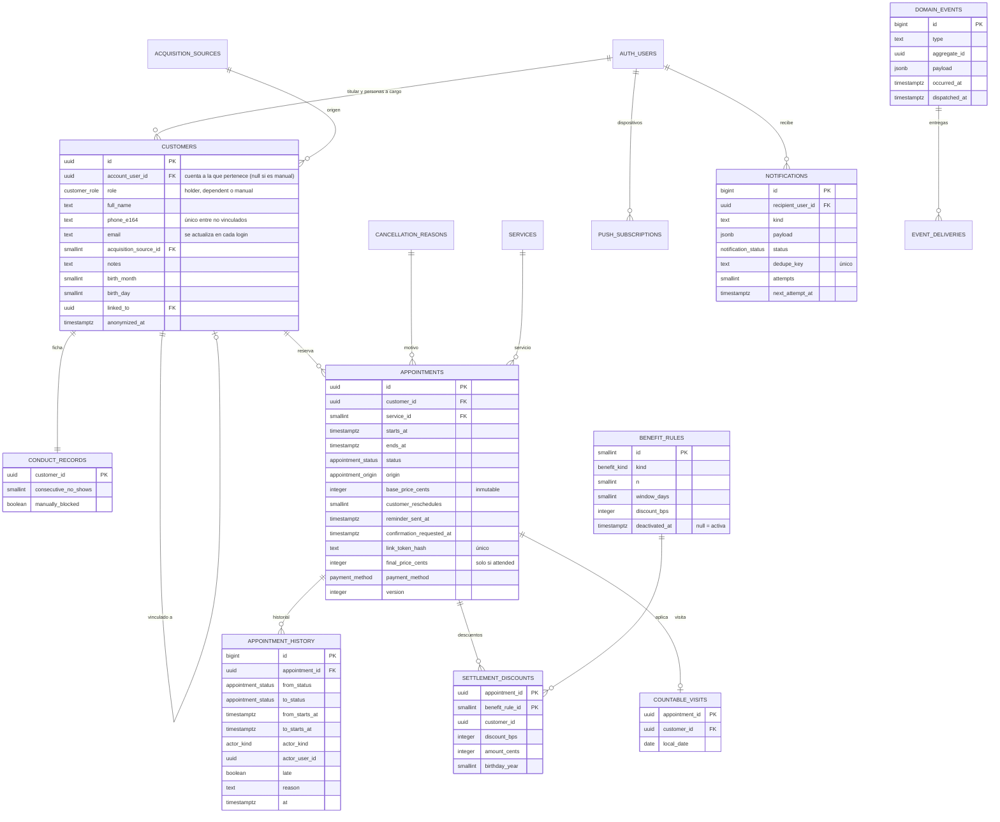

# Diseño 2 — Base de datos

Estado: aprobado (2026-11-20), con los ajustes de redundancia (DB-07)
Parte de: Diseño → 1. Arquitectura ✅ · **2. Base de datos** · 3. Backend · 4. Interfaz
Entrada: [`docs/dominio.md`](../dominio.md) (agregados e invariantes), [`01-arquitectura.md`](01-arquitectura.md) (ADR-02 a ADR-06)
Guía: skills `supabase` y `supabase-postgres-best-practices`

> Esquema objetivo completo de Postgres (Supabase). No se crea todo junto: cada spec SDD agrega con su
> migración la parte que necesita. Este documento es el mapa que todas respetan.

---

## 1. Principios del esquema

| # | Principio | De dónde sale |
|---|---|---|
| 1 | **Un esquema por propósito**: `app` (datos del negocio), `stats` (vistas de lectura). **Ninguno se publica en la Data API.** | ADR-02 |
| 2 | **Cada tabla pertenece a un módulo** y solo el código de ese módulo la escribe. Las referencias entre módulos son por clave foránea al identificador, nunca por columnas copiadas. | Dominio §1 |
| 3 | **La base garantiza lo que nunca puede fallar**: horario único, transiciones válidas, precio inmutable, montos enteros. El resto de las reglas viven en TypeScript. | ADR-04 |
| 4 | **Instantes en `timestamptz` (UTC)**; fechas del calendario del local en `date`, calculadas en la zona del local. | Constitución, principio 6 |
| 5 | **Montos en centavos (`integer`)**, sumas en `bigint`, porcentajes en **puntos básicos** (`1500` = 15 %). Nada de `float` ni `numeric` para plata. | Constitución, principio 7 |
| 6 | **RLS activado en todas las tablas**, aunque no se expongan (defensa en profundidad). | Skill `supabase`, regla 5 |
| 7 | **Nombres en inglés, minúscula y `snake_case`**; `text` en lugar de `varchar`; `check` para todos los rangos. | Skill de Postgres (`schema-*`), constitución, principio 10 |
| 8 | **Claves:** `uuid` en lo que se ve en URLs o se comparte entre módulos (turnos, clientes); `bigint identity` en tablas internas de alto volumen (historial, outbox, notificaciones). | Skill de Postgres (`schema-primary-keys`), volumen de una barbería |
| 9 | **Toda clave foránea tiene su índice.** | Skill de Postgres (`schema-foreign-key-indexes`) |
| 10 | **Migraciones idempotentes y una por cambio**, creadas con `supabase migration new`. | Skill `supabase` |

## 2. Diagrama entidad-relación



Las tablas de configuración (una fila cada una) y los catálogos simples están en la sección 3 y no
se dibujan para no ensuciar el diagrama.

## 3. Tablas por módulo

### 3.1 Agenda (`schedule`)

| Tabla | Columnas clave | Restricciones |
|---|---|---|
| `schedule_settings` (1 fila) | `step_minutes` (15, paso de la agenda), `min_notice_minutes` (30), `max_advance_days` (30), `approval_min_notice_minutes` (120) | `id = 1`; `slot_minutes between 5 and 240`; resto `> 0` |
| `weekly_ranges` | `id`, `weekday` (1 = lunes … 7 = domingo), `opens_at time`, `closes_at time` | `closes_at > opens_at`; **sin superposición en el mismo día** (I-8) con `exclude using gist (weekday with =, tsrange(date '2000-01-01' + opens_at, date '2000-01-01' + closes_at) with &&)` (sin tipo de rango propio: el revisor de Supabase marca sus constructores) |
| `schedule_blocks` | `id`, `period tstzrange`, `reason`, `created_by` | `not isempty(period)`; índice GiST en `period` |

Las horas de las franjas se llevan a una fecha fija (`2000-01-01`) para usar `tsrange` en la exclusión: un tipo de rango propio sobre `time` crearía constructores que el revisor de seguridad de Supabase marca y que la migración no puede corregir.
La exclusión usa la extensión `btree_gist` para combinar `=` y `&&`.

### 3.2 Clientes (`customers`)

| Tabla | Columnas clave | Restricciones |
|---|---|---|
| `customers` | ver diagrama; `created_at`. `email` se copia del login (solo del titular) para poder buscar sin cruzar con el esquema de Auth y **se actualiza en cada ingreso** | **un titular por cuenta**: índice único parcial `(account_user_id) where role = 'holder'`; `role = 'manual'` ⇔ `account_user_id is null`; **las personas a cargo no tienen teléfono ni email** (`check`); teléfono obligatorio para titulares y manuales no anonimizados; el máximo de [5] personas a cargo lo controla el caso de uso (con la fila del titular bloqueada); `phone_e164 ~ '^\+[1-9][0-9]{7,14}$'`; **teléfono único entre clientes activos no vinculados** (I-10): índice único parcial `where linked_to is null and anonymized_at is null`; fecha de nacimiento válida (`birth_month between 1 and 12`, día según el mes, 29/2 permitido); `linked_to <> id` |
| `acquisition_sources` | `id smallint`, `name`, `position`, `active` | `name` único |

- **Baja de datos (RNF-07):** no se borra la fila (los turnos pasados sostienen las estadísticas). Se
  anonimiza: nombre "Cliente eliminado", teléfono, email, notas y nacimiento en `null`, y se completa
  `anonymized_at`. Una restricción exige teléfono salvo en clientes anonimizados.
- Búsqueda por nombre o teléfono (P-08): índice trigram (`pg_trgm`) sobre `full_name` y sobre
  `phone_e164`.

### 3.3 Turnos (`appointments`, núcleo)

**Tipos:**

```sql
create type app.appointment_status as enum (
  'pending_approval', 'booked', 'confirmed', 'unconfirmed',        -- activos
  'rejected', 'cancelled', 'cancelled_late', 'released',           -- finales sin visita
  'attended', 'no_show'                                            -- finales con marca
);
create type app.appointment_origin as enum ('app', 'manual');
create type app.actor_kind        as enum ('customer', 'guest', 'barber', 'system');
create type app.payment_method    as enum ('cash', 'transfer', 'mercado_pago', 'other');
create type app.customer_role     as enum ('holder', 'dependent', 'manual');
```

**`appointments`** (columnas además de las del diagrama): `booked_at`, `booked_by_kind`,
`cancellation_reason_id`, `barber_note` (motivo obligatorio cuando cancela o reprograma el barbero),
`attended_marked_at`, `created_at`, `updated_at`.

| Garantía | Cómo | Invariante |
|---|---|---|
| **Dos turnos activos nunca se superponen**, aunque sean de servicios con distinta duración | `exclude using gist (tstzrange(starts_at, ends_at, '[)') with &&) where (status in ('pending_approval','booked','confirmed','unconfirmed'))` | I-2 |
| Un turno futuro activo por cliente | **No se puede expresar con un índice** ("futuro" depende de la hora). El caso de uso bloquea la fila del cliente (`select … for update`) y cuenta sus turnos activos futuros dentro de la misma transacción | I-3 |
| Transiciones válidas | *Trigger* `before update of status` que valida el par (anterior, nuevo) contra la tabla de transiciones de `dominio.md` §6 | I-1 |
| Precio base inmutable | *Trigger* que rechaza cambios de `base_price_cents` después del alta | I-4 |
| Liquidación solo si asistió | `check ((status = 'attended') = (final_price_cents is not null))` | I-6 |
| Montos válidos | `base_price_cents >= 0`, `final_price_cents between 0 and base_price_cents` | — |
| Horario coherente | `ends_at > starts_at` | — |
| Límite de reprogramaciones | `customer_reschedules between 0 and 2` (el máximo real sale de la política; el `check` es el techo) | I-7b |
| Enlace secreto | Se guarda **el hash SHA-256 del token**, nunca el token. Único. No tiene vencimiento propio: vale mientras el turno esté activo y no haya terminado (`status` y `ends_at`) | RNF-06 |
| Concurrencia optimista | `version` se incrementa en cada cambio; el repositorio actualiza `where id = … and version = …` | — |

**`appointment_history`** (historial y auditoría, RNF-13): una fila por cada cambio de estado o de
horario, escrita en la misma transacción. **Solo inserción**: el rol de la app no tiene `update` ni
`delete` sobre esta tabla.

**`appointment_policy`** (1 fila): `cancel_notice_minutes` (240), `confirmation_lead_minutes` (60),
`confirmation_window_minutes` (30), `undo_window_minutes` (10), `reminder_local_time` (20:00),
`max_customer_reschedules` (2), `attendance_correction_hours` (48).

**`cancellation_reasons`**: catálogo configurable (`id`, `name`, `position`, `active`).

### 3.4 Conducta (`conduct`)

| Tabla | Columnas clave | Restricciones |
|---|---|---|
| `conduct_records` | ver diagrama, `updated_at` | `consecutive_no_shows >= 0` (I-12); se crea junto con el cliente. Las cancelaciones y reprogramaciones tarde **no** se guardan acá: se cuentan desde el historial en `stats.customer_facts` |
| `conduct_settings` (1 fila) | `approval_threshold` (3) | `>= 1` |
| `processed_events` *(compartida, ver 3.7)* | — | Evita contar dos veces la misma falta |

La **habilitación** (normal / requiere aprobación / bloqueado) no se guarda: se calcula (I-13).

`consecutive_no_shows` es una **proyección** (ver sección 3.8): cada evento de asistencia la **recalcula** contando las faltas desde la última asistencia del cliente, nunca le suma o resta 1.

### 3.5 Precios y beneficios (`pricing`)

| Tabla | Columnas clave | Restricciones |
|---|---|---|
| `services` | `id smallint`, `name`, `description`, `duration_minutes`, `price_cents`, `counts_for_benefits`, `position`, `deactivated_at` | `price_cents > 0`; `duration_minutes > 0` y múltiplo del paso (lo valida el caso de uso, porque el paso vive en otra tabla); `name` único entre los activos (I-16). Datos iniciales: Corte, Completo, Claritos (D-10) |
| `benefit_rules` | ver diagrama, `created_at`. Activa = `deactivated_at is null` | `kind in ('nth_in_month','every_nth','birthday')`; `n >= 1` salvo `birthday`; `window_days` solo en `birthday`; `discount_bps between 100 and 10000` (I-14) |
| `countable_visits` | ver diagrama, `created_at` | Una por turno asistido; índice `(customer_id, local_date)`. Es una **proyección** (sección 3.8) |
| `settlement_discounts` | ver diagrama, `kind` | **Cumpleaños una vez por año** (I-14b): índice único parcial `(customer_id, birthday_year) where kind = 'birthday'` |

Al corregir una asistencia (P-06) se borran la visita computable y los descuentos de ese turno en la
misma transacción, y se vuelven a crear si corresponde.

### 3.6 Notificaciones (`notifications`)

| Tabla | Columnas clave | Restricciones e índices |
|---|---|---|
| `push_subscriptions` | `id`, `user_id`, `endpoint`, `p256dh`, `auth_secret`, `user_agent`, `last_success_at`, `failure_count` | `endpoint` único; se borra al recibir "410 Gone" del servicio de push |
| `notifications` | ver diagrama, `appointment_id`, `sent_at`, `read_at`, `last_error` | `dedupe_key` único (idempotencia: `confirmation_request:<turno>`); índice parcial `(next_attempt_at) where status = 'pending'` |
| `notification_settings` (1 fila) | `daily_summary_local_time` (08:00) | — |

Las notificaciones a un cliente sin cuenta no existen como push: su información está en la página del
enlace. El barbero ve igual el aviso dentro de la app.

### 3.7 Compartido: outbox y procesamiento idempotente

| Tabla | Columnas clave | Uso |
|---|---|---|
| `domain_events` | ver diagrama | Se inserta en la misma transacción que el cambio (ADR-05). Índice parcial `(id) where dispatched_at is null` |
| `event_deliveries` | `event_id`, `handler`, `processed_at`, `attempts`, `last_error` | PK `(event_id, handler)`: cada suscriptor procesa cada evento **una sola vez**. Cuando todos terminan, se completa `dispatched_at` |
| `system_status` (1 fila) | `last_tick_at`, `last_tick_summary jsonb` | Salud del reloj: la usan `/api/health` y `tick-healthcheck` (agregada por el diseño del backend, §6) |
| `used_action_tokens` | `token_id` (PK), `used_at`, `expires_at` | Tokens de acción de notificaciones de **un solo uso** (backend §7.3); se purgan al vencer |
| `rate_limit_hits` | `key` (por ejemplo, `link:<ip>`), `window_start`, `count` | Límite de intentos fallidos en la página del enlace (backend §9) |

El despachador toma eventos con `for update skip locked` (skill de Postgres, `lock-skip-locked`): si
dos tics del cron se superponen, no procesan lo mismo ni se bloquean entre sí. Lo mismo para
`processDueActions` y el envío de notificaciones.

Retención: una tarea semanal borra eventos despachados con más de 30 días y las respuestas viejas de `pg_net`.

### 3.8 Redundancia: qué hay y cómo se mantiene consistente

El esquema está normalizado; la redundancia que queda es intencional y de tres tipos.

| Tipo | Columnas | Por qué existe | Cómo no se desincroniza |
|---|---|---|---|
| **Fotos históricas** | `appointments.base_price_cents`, `appointments.ends_at`, `settlement_discounts.kind` | Congelan hechos que pueden cambiar después (precio D-09, duración del servicio, regla de descuento) | No se desincronizan: son el registro de lo que pasó |
| **Atajos dentro del agregado** | `appointments.status` (vs. historial), `final_price_cents`, `customer_reschedules`, `domain_events.dispatched_at`, `settlement_discounts.customer_id` y `birthday_year` | Velocidad de consulta, restricciones e índices que necesitan el dato en la misma fila | Se escriben en la **misma transacción** que su origen |
| **Proyecciones entre módulos** | `countable_visits` (Precios), `conduct_records.consecutive_no_shows` (Conducta) | Cada módulo decide con sus propios datos, sin leer las tablas de Turnos (bajo acoplamiento) | Se **recalculan desde cero** con cada evento (idempotentes ante duplicados y correcciones P-06) y una **reconciliación** las compara con el origen |

**Reconciliación:** un test de integración y un control en la tarea `retention` (semanal) comparan
cada proyección con lo que dicen los turnos. Si difieren, se registra una alerta para revisar y se
puede reconstruir la proyección desde el origen.

Se descartaron por redundantes sin beneficio: `appointments.discount_bps_total` (está en
`settlement_discounts`), `appointments.link_expires_at` (lo dicen `status` y `ends_at`),
`benefit_rules.active` (lo dice `deactivated_at`) y los contadores de cancelaciones y
reprogramaciones tarde en `conduct_records` (se cuentan en `stats`).

> **Actualización (spec 002, 2026-11-21), implementada en `supabase/migrations/20261121200*`:**
> - `customer_role` es `holder`, `dependent` o **`guest`** (antes `manual`), más `registered_by`
>   (`self` o `barber`): el invitado que se registra solo y el cliente que carga Colo son la misma figura.
> - Columnas nuevas en `customers`: `nickname` (solo lo ve Colo), `is_demo` (con `check` de "(demo)" en
>   el nombre), `birth_day`/`birth_month` sin año. El titular nace sin teléfono (perfil incompleto); el
>   invitado siempre tiene teléfono y nunca cuenta.
> - Tablas nuevas de identidad: `guest_devices`, `demo_accounts`, `user_activity`, `phone_changes`
>   (retención de 12 meses) y `guest_attempts` (hash de la IP, retención de 1 día). Limpieza diaria con
>   pg_cron (`retencion-diaria`).
> - `app_server` puede crear y actualizar clientes, nunca borrarlos.
> - Las reglas de un `check` necesitan `is not null` explícito: una comparación con `null` no falla.

## 4. Estadísticas (`stats`)

Vistas de **solo lectura** que calculan en Postgres (aprendizaje de Corralap). Agrupan siempre en la
hora del local.

| Vista | Una fila por | Columnas principales |
|---|---|---|
| `stats.appointment_facts` | turno | `local_date`, `local_hour`, `iso_weekday`, `status`, `origin`, `customer_id`, `service_id`, `duration_minutes`, `base_price_cents`, `final_price_cents`, `discount_cents`, `booked_lead_minutes`, `confirmed_in_window`, `late` |
| `stats.customer_facts` | cliente | `first_visit`, `last_visit`, `visits`, `billed_cents`, `median_gap_days`, `next_appointment_at`, `acquisition_source`, faltas, cancelaciones tarde y reprogramaciones tarde (contadas desde `appointment_history`) |
| `stats.offered_capacity` | día | horarios ofrecidos por día (para la ocupación), calculados desde franjas y bloqueos |

Cada indicador de [`estadisticas-crm.md`](../estadisticas-crm.md) es una consulta de agregación sobre
estas vistas, con el período y la granularidad como parámetros (`date_bin` / `date_trunc` sobre la
fecha local). Si alguna consulta se vuelve lenta, la vista pasa a ser materializada y se refresca en el
tic del cron; con el volumen de una barbería (miles de turnos por año) no debería hacer falta.

Las vistas se crean con `security_invoker = true` (skill `supabase`: las vistas saltean RLS por defecto).

## 5. Seguridad: roles, permisos y RLS

| Rol | Uso | Permisos |
|---|---|---|
| `app_server` | Lo usa Next.js por el *pooler* (ADR-02) | `usage` en `app` y `stats`; `select, insert, update` en las tablas de `app`; `delete` solo donde el diseño lo pide (suscripciones vencidas, correcciones, retención); **sin** `update`/`delete` en `appointment_history`; `select` en `stats` |
| `anon`, `authenticated` | Roles de la Data API de Supabase | **Ningún permiso** sobre `app` ni `stats`. Los esquemas no están expuestos |
| `postgres` | Migraciones (CLI de Supabase) | Dueño de los objetos |

- **RLS activado en todas las tablas de `app`**, con una sola política por tabla:
  `for all to app_server using (true) with check (true)`. Si por error alguien expone el esquema, los
  roles de la Data API no ven nada.
- La autorización por usuario ("un cliente solo ve sus turnos", RNF-06) la hace la capa de acceso
  del servidor (ADR-07) con el `customerId` de la sesión, y se prueba con tests de integración.
- Ninguna función `security definer` en esquemas expuestos (skill `supabase`).
- El secreto del cron y la URL de la app se guardan en **Supabase Vault**, no en el código.

## 6. Tareas programadas (Supabase Cron)

| Tarea | Frecuencia | Qué hace |
|---|---|---|
| `tick` | cada minuto | `net.http_post` a `/api/cron/tick` con el secreto de Vault (ADR-06) |
| `retention` | domingos 04:17 | Borra eventos despachados viejos, notificaciones leídas de más de 90 días y respuestas de `pg_net`; **reconcilia las proyecciones** (sección 3.8) y registra una alerta si difieren |
| `tick-healthcheck` | cada 10 minutos | Si el último tic exitoso tiene más de 5 minutos, registra una alerta para el barbero (riesgo de §7 de la arquitectura) |

## 7. Ejemplo: cómo se protege una reserva

```sql
begin;
  -- I-3: serializa las reservas de un mismo cliente
  select id from app.customers where id = $customer for update;
  select count(*) from app.appointments
   where customer_id = $customer
     and status in ('pending_approval','booked','confirmed','unconfirmed')
     and starts_at > now();                        -- si es > 0, el caso de uso aborta

  -- I-2: si otro tomó el horario, la restricción de exclusión falla (código 23P01)
  insert into app.appointments (id, customer_id, starts_at, ends_at, status, origin, base_price_cents, …)
  values (…);

  insert into app.appointment_history (…);       -- RNF-13
  insert into app.domain_events (type, aggregate_id, payload) values ('AppointmentBooked', …);
commit;
```

El repositorio traduce el error `23P01` (violación de exclusión) a `SLOT_TAKEN`, que la interfaz
muestra como "Ese horario ya no está disponible".

## 8. Orden de migraciones por spec

| Spec | Migraciones que agrega |
|---|---|
| 001 agenda | extensiones (`btree_gist`, `pg_trgm`), esquemas `app`/`stats`, rol `app_server`, `schedule_*`, `weekly_ranges`, `services` |
| 002 login | `customers`, `acquisition_sources`, `conduct_records` (vacía) |
| 003 reservas | tipos de turno, `appointments`, `appointment_history`, `appointment_policy`, `cancellation_reasons`, triggers, `domain_events`, `event_deliveries` |
| 004 manuales | columna del enlace (`link_token_hash`), `rate_limit_hits` |
| 005 PWA | `push_subscriptions`, `notifications`, `notification_settings`, `used_action_tokens` |
| 006 confirmación | extensiones `pg_cron` y `pg_net`, `system_status`, tareas `tick` y `tick-healthcheck`, secretos en Vault |
| 007 asistencia | `conduct_settings`, liquidación en `appointments`, `payment_method` |
| 008 beneficios | `benefit_rules`, `countable_visits`, `settlement_discounts` |
| 010 estadísticas | esquema `stats` con sus vistas, tarea `retention` |

## 9. Cómo se prueba

- **Tests de integración** (Vitest contra el Postgres local de `supabase start`, ADR-12) para cada garantía de la sección 3.3: doble reserva simultánea, transición inválida, cambio de precio, liquidación sin asistencia, cumpleaños dos veces en el año.
- **Tests de reconciliación** de las proyecciones: después de una secuencia de asistencias, faltas, correcciones y eventos duplicados, `countable_visits` y `consecutive_no_shows` coinciden con lo que dicen los turnos.
- **`supabase db advisors`** en CI para detectar tablas sin RLS, índices faltantes y funciones inseguras.
- **Tipos generados** (`kysely-codegen`) en CI: si una migración cambia una tabla y el código no se actualiza, falla el typecheck.

## 10. Decisiones de este diseño (para aprobar)

- **DB-01.** Exclusión por rango de tiempo en lugar de índice único por hora de inicio: con servicios de distinta duración (D-10), es la única forma de impedir superposiciones.
- **DB-02.** "Un turno futuro por cliente" se garantiza con bloqueo de la fila del cliente, no con un índice: un turno pasado sin marcar no debería impedir reservar el siguiente.
- **DB-03.** Configuración en tablas de una fila por módulo (no un JSON de ajustes ni variables de entorno): cada módulo es dueño de sus parámetros y el barbero los edita desde la app.
- **DB-04.** El token del enlace se guarda hasheado: si se filtra la base, los enlaces no sirven.
- **DB-05.** Baja de datos por anonimización, no por borrado: se respetan los datos del cliente y no se rompen las estadísticas.
- **DB-06.** Estadísticas con vistas normales (no materializadas) hasta que haga falta.
- **DB-07.** Redundancia solo intencional (sección 3.8): proyecciones que se recalculan y se reconcilian; se eliminaron cinco columnas redundantes sin beneficio.

## 11. A verificar en la implementación

- Que el *pooler* de Supabase acepte el rol propio `app_server` (si no, el servidor usa el rol por defecto del pooler y se compensa con los mismos permisos mínimos).
- La versión de Postgres del proyecto (si es 18 o más, `uuidv7()` nativo reemplaza a `gen_random_uuid()` en las tablas con `uuid`).
- Los nombres actuales de las funciones de Vault y `pg_net` contra la documentación de Supabase (la skill pide revisar el changelog antes de implementar).
