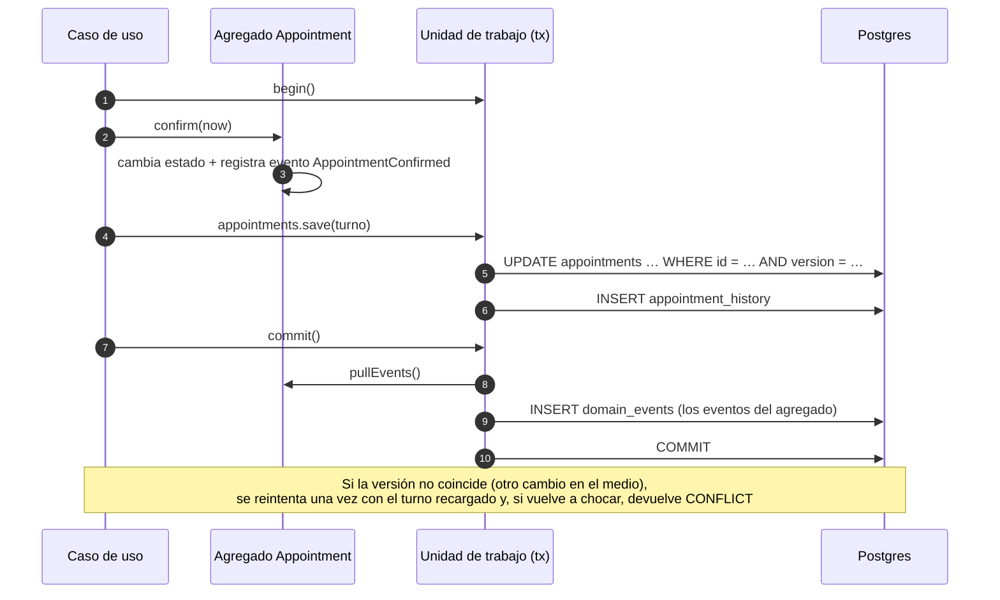
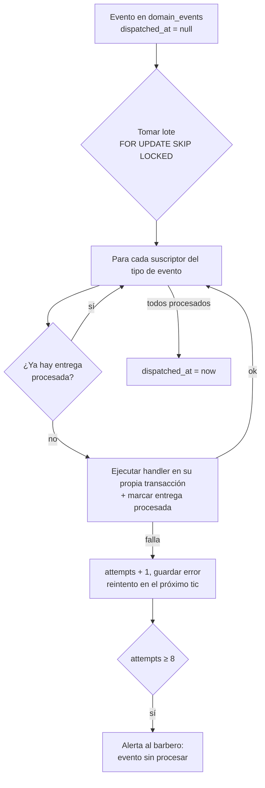
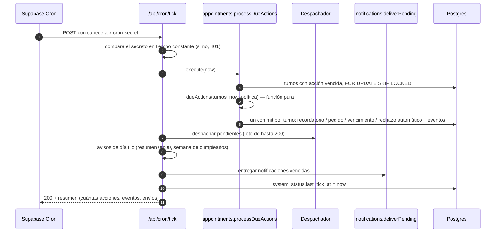
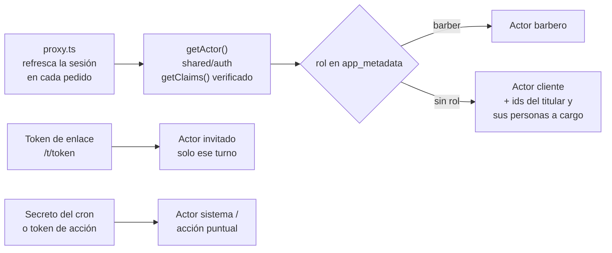

# Diseño 3 — Backend

Estado: aprobado (2026-11-20)
Parte de: Diseño → 1. Arquitectura ✅ · 2. Base de datos ✅ · **3. Backend** · 4. Interfaz
Entrada: [`01-arquitectura.md`](01-arquitectura.md), [`02-base-de-datos.md`](02-base-de-datos.md), [`casos-de-uso.md`](../casos-de-uso.md)

> Cómo se implementan, dentro de Next.js, los casos de uso, los eventos, el reloj, las notificaciones,
> la sesión y los errores. Es el "manual de construcción" que siguen los `plan.md` de cada spec.

---

## 1. Anatomía de un caso de uso

Todos los casos de uso tienen la misma forma. Eso hace que cada spec sea predecible y fácil de probar.

```ts
// modules/appointments/application/book-appointment.ts
export type BookAppointmentInput = { customerId: CustomerId; serviceId: ServiceId; slotStart: Instant };

export type BookAppointmentError =
  | 'SLOT_NOT_OFFERED' | 'SLOT_TAKEN' | 'ALREADY_HAS_ACTIVE'
  | 'CUSTOMER_BLOCKED' | 'NOT_ALLOWED';

export function makeBookAppointment(deps: {
  appointments: AppointmentRepository;   // puerto propio
  schedule: ScheduleQuery;               // puerto hacia Agenda
  eligibility: EligibilityQuery;         // puerto hacia Conducta
  services: ServiceCatalog;              // puerto hacia Precios (servicio, precio, duración)
  policy: AppointmentPolicyRepository;
}) {
  return async function execute(
    input: BookAppointmentInput,
    ctx: UseCaseContext,                 // { now, actor, uow }
  ): Promise<Result<AppointmentView, BookAppointmentError>> {
    // 1. autorizar   2. consultar puertos   3. aplicar dominio puro
    // 4. guardar con ctx.uow (agregado + historial + eventos)   5. devolver la vista
  };
}
```

| Pieza | Qué es | Por qué |
|---|---|---|
| `make…(deps)` | Fábrica que recibe los puertos | Inyección de dependencias sin librerías: en los tests se pasan versiones en memoria |
| `ctx.now` | La hora, recibida desde afuera | Ninguna regla lee el reloj por su cuenta (constitución, principio 3) |
| `ctx.actor` | Quién ejecuta: cliente, invitado, barbero o sistema | La autorización es parte del caso de uso, no de la pantalla |
| `ctx.uow` | Unidad de trabajo: una transacción de Kysely | Todo lo que se guarda en el caso de uso entra o sale junto (ADR-03) |
| `Result<T, E>` | Éxito o error de negocio con un código | Los errores esperados no son excepciones (sección 8) |

**Comandos y consultas separados.** Los **comandos** (reservar, cancelar, marcar asistencia) cargan el
agregado, aplican reglas y guardan. Las **consultas** (agenda del día, mis turnos, indicadores) no
cargan agregados: leen directo con SQL la forma que necesita la pantalla. Así las pantallas son rápidas
y el dominio no se llena de métodos de lectura.

## 2. Unidad de trabajo y eventos

Los agregados acumulan sus eventos de dominio; la unidad de trabajo los guarda en el outbox **en la
misma transacción**.



## 3. Composición: dónde se arma todo

`src/server/composition.ts` es el **único** archivo que conoce las implementaciones concretas de todos
los módulos (repositorios SQL, adaptadores, web-push) y arma los casos de uso. Las Server Actions y
Route Handlers piden el caso de uso ya armado:

```ts
// modules/appointments/interface/actions.ts
'use server';
export async function bookAppointmentAction(raw: unknown) {
  const input = BookAppointmentSchema.parse(raw);          // forma (Zod)
  const actor = await requireActor('customer');            // sesión verificada
  return runUseCase(useCases.bookAppointment, input, actor); // transacción, now, mapeo de errores
}
```

El test de arquitectura permite que solo `src/server/` importe `infrastructure` de los módulos.

## 4. Catálogo de comandos por módulo

| Módulo | Comandos | Actor | Eventos que publica |
|---|---|---|---|
| **appointments** | `bookAppointment`, `bookManualAppointment`, `approveAppointment`, `rejectAppointment`, `confirmAppointment`, `keepAppointment`, `releaseAppointment`, `cancelAppointment`, `rescheduleAppointment`, `markAttendance`, `correctAttendance`, `processDueActions` | cliente, invitado, barbero, sistema | Todos los de `dominio.md` §7 |
| **schedule** | `updateScheduleSettings`, `setWeeklyRanges`, `addBlock`, `removeBlock` | barbero | `SlotBlocked` |
| **customers** | `registerCustomer` (primer login: crea el titular), `addDependent`, `updateDependent`, `removeDependent`, `updateProfile`, `createManualCustomer`, `linkCustomers`, `updateNotes`, `anonymizeCustomer` | cliente, barbero | `CustomerRegistered`, `CustomerLinked`, `CustomerAnonymized` |
| **conduct** | `blockCustomer`, `unblockCustomer`, `updateConductSettings` | barbero | `NoShowThresholdReached` |
| **pricing** | `createService`, `updateService`, `deactivateService`, `createBenefitRule`, `deactivateBenefitRule` | barbero | `BenefitReached` |
| **notifications** | `subscribePush`, `unsubscribePush`, `markRead`, `deliverPending` | cliente, barbero, sistema | — |

**Puertos entre módulos** (los define quien pregunta, en su `application`):

| Puerto (en appointments) | Lo implementa | Devuelve |
|---|---|---|
| `ScheduleQuery.offeredSlots(range, now, duration, audience)` | schedule | Inicios donde un servicio de esa duración entra completo (con anticipación de 2 h para clientes que requieren aprobación) |
| `EligibilityQuery.of(customerId)` | conduct | `normal` / `requires_approval` / `blocked` |
| `ServiceCatalog.get(serviceId)` / `.active()` | pricing | Servicio con precio vigente en centavos, duración y si suma para beneficios |
| `SettlementCalculator.settle(customerId, serviceId, localDate, basePrice)` | pricing | Liquidación con descuentos (sin descuentos si el servicio no suma) |
| `CustomerDirectory.contact(customerId)` | customers | Nombre y teléfono (para el mensaje de WhatsApp) |

## 5. Despachador de eventos



**Suscripciones** (registradas en `src/server/composition.ts`):

| Evento | Suscriptores |
|---|---|
| `AppointmentBooked`, `ApprovalRequested`, `Approved`, `Rejected`, `Confirmed`, `ConfirmationRequested`, `ConfirmationExpired`, `Released`, `Cancelled`, `Rescheduled`, `DayBeforeReminderDue` | notifications (arma la notificación del destinatario que corresponde) |
| `AttendanceRegistered`, `AttendanceCorrected` | conduct (**recalcula** faltas seguidas), pricing (**recalcula** visitas computables y evalúa beneficios) |
| `NoShowThresholdReached`, `BenefitReached` | notifications |
| `SlotBlocked` | appointments (cancela como barbero los turnos activos del rango, con el motivo del bloqueo) |
| `CustomerRegistered` | conduct (crea la ficha) |

- **Camino rápido:** después de responder, la Server Action llama al despachador con `after()` de
  Next.js para los eventos que acaba de generar. El usuario no espera.
- **Camino seguro:** el tic de cada minuto despacha todo lo pendiente.
- **Idempotencia:** cada handler está escrito para que ejecutarlo dos veces dé lo mismo (recalcular en
  vez de sumar, `dedupe_key` en notificaciones) y además `event_deliveries` evita ejecutarlo dos veces.

## 6. El tic de cada minuto

`POST /api/cron/tick`, llamado por Supabase Cron (ADR-06).



| Regla | Detalle |
|---|---|
| Presupuesto de tiempo | Cada paso tiene un tope (por ejemplo, 15 s en total). Lo que no entra queda para el próximo tic |
| Idempotencia | Recordatorio y pedido se marcan en el turno (`reminder_sent_at`, `confirmation_requested_at`); los avisos de día fijo usan `dedupe_key` (`daily_summary:2026-11-21`, `birthday:<cliente>:2026`) |
| Tolerancia a atrasos | `dueActions` decide por **"ya pasó el momento"**, no por "es exactamente el minuto". Si un tic se pierde, el siguiente hace lo pendiente |
| Salud | Se guarda `last_tick_at` en la tabla de una fila `app.system_status`; `/api/health` y la tarea `tick-healthcheck` lo revisan |
| Seguridad | Solo `POST`, secreto de 32 bytes en Vault y en Vercel, comparación en tiempo constante, sin datos en la respuesta |

> La tabla `app.system_status`, junto con `used_action_tokens` (§7.3) y `rate_limit_hits` (§9), quedó
> agregada al diseño de base de datos, sección 3.7.

## 7. Notificaciones

### 7.1 De evento a notificación

El handler de notificaciones transforma cada evento en una fila de `notifications` con su
destinatario, su texto (plantillas en español rioplatense) y su `dedupe_key`. El texto se arma
**en el momento del evento** y queda guardado: si después cambia algo, el aviso enviado no cambia.

| Ejemplo de evento | Destinatario | Texto | Acciones |
|---|---|---|---|
| `ConfirmationRequested` | cliente | "¿Confirmás tu turno de hoy a las 16:00?" | Confirmar · Cancelar |
| `ConfirmationExpired` | barbero | "Juan no confirmó las 16:00" | Mantener · Liberar |
| `Rescheduled` (por cliente) | barbero | "Juan pasó su turno del jueves 16:00 al viernes 11:00" | Ver |
| `Cancelled` (por barbero) | cliente | "Cancelé tu turno del jueves 16:00: me surgió un imprevisto. ¿Elegís otro horario?" | Reservar |

### 7.2 Envío con reintentos

| Respuesta del servicio de push | Qué hace el sistema |
|---|---|
| 201 | `sent`; actualiza `last_success_at` de la suscripción |
| 404 / 410 | La suscripción ya no existe: se borra; si el usuario no tiene otra, queda solo el aviso dentro de la app |
| 429 / 5xx / sin red | Reintento con espera creciente: 1, 2, 5, 15 y 60 min (5 intentos). Después, `failed` y queda visible dentro de la app |

- **TTL** de cada push igual a su vigencia: un pedido de confirmación no sirve después de la ventana de 30 min, así que vence ahí.
- **Urgencia alta** para pedido de confirmación, vencimiento y cancelaciones; normal para el resto.
- Todas las notificaciones también se ven en la campanita de la app, aunque el push falle (RF-34, RNF-10).

### 7.3 Botones dentro de la notificación

El service worker no tiene garantizada la cookie de sesión cuando el usuario toca "Confirmar" con la
app cerrada. Por eso cada notificación con acciones lleva un **token de acción**:

- firmado con HMAC (`ACTION_TOKEN_SECRET`), con el turno, la acción, el usuario y el vencimiento;
- de **un solo uso** (se registra al usarlo) y vence con la ventana de la acción;
- el service worker lo manda a `POST /api/notifications/action`, que lo verifica y ejecuta el mismo
  caso de uso que la pantalla (`confirmAppointment`, `releaseAppointment`…).

Si el token venció, la notificación abre la app en el turno para que el usuario lo resuelva ahí.

## 8. Errores

| Tipo | Ejemplo | Cómo viaja | Qué ve el usuario |
|---|---|---|---|
| **De negocio** (esperados) | `SLOT_TAKEN`, `LATE_CANCELLATION_REQUIRES_CONFIRMATION`, `RESCHEDULE_LIMIT_REACHED` | `Result.err(código)` | Mensaje claro en español, desde un catálogo único (`shared/errors/messages.ts`) |
| **De entrada** | Fecha mal formada | Zod → `INVALID_INPUT` con los campos | El campo marcado en el formulario |
| **De autorización** | Un cliente intenta cancelar un turno ajeno | `NOT_ALLOWED` | "No podés hacer esto" (sin decir si el turno existe) |
| **De concurrencia** | Dos cambios simultáneos al mismo turno | `CONFLICT` después de un reintento | "El turno cambió, actualizamos la pantalla" |
| **Inesperados** | Se cayó la base | Excepción → se registra con un id | "Algo salió mal, probá de nuevo (código ABC123)" |

**Logs:** JSON estructurado (nivel, módulo, caso de uso, id de pedido, duración, código de error) en
los logs de Vercel. **Nunca** nombres, teléfonos, emails, tokens ni notas (RNF-07, constitución, principio 8).

## 9. Sesión, identidad y autorización



- **`getActor()`** es el único lugar que lee la sesión (se memoriza por pedido con `cache` de React).
- **Primer login de un cliente:** `auth/callback` crea el cliente (`registerCustomer`) si no existe,
  actualiza su email y lo lleva a completar el teléfono (RF-02).
- **Alta del barbero:** la variable `BARBER_EMAIL` indica su cuenta. En su primer login, el callback le
  asigna `app_metadata.role = 'barber'` con la clave secreta de Supabase (que solo existe en el servidor
  y solo se usa ahí). Nadie más puede volverse barbero.
- **Autorización** en cada caso de uso: un titular solo actúa sobre sus turnos y los de sus personas a cargo (el actor trae la lista de clientes de su cuenta); un invitado solo sobre
  el turno de su enlace; las acciones de configuración son solo del barbero.
- **Enlace de invitado:** el token se compara por su hash (DB-04). Para evitar que alguien pruebe
  tokens al azar, hay un límite de intentos fallidos por IP (contador en la base, ventana de 10 min).

## 10. Configuración y secretos

| Variable | Dónde | Para qué |
|---|---|---|
| `NEXT_PUBLIC_SUPABASE_URL`, `NEXT_PUBLIC_SUPABASE_PUBLISHABLE_KEY` | Navegador y servidor | Login con Google (clave publicable, no secreta) |
| `SUPABASE_SECRET_KEY` | Solo servidor | Asignar el rol de barbero |
| `DATABASE_URL` | Solo servidor | Conexión al pooler con el rol `app_server` |
| `CRON_SECRET` | Servidor y Vault | Autenticar el tic |
| `ACTION_TOKEN_SECRET`, `LINK_HASH_PEPPER` | Solo servidor | Firmar tokens de acción; hashear tokens de enlace |
| `NEXT_PUBLIC_VAPID_PUBLIC_KEY`, `VAPID_PRIVATE_KEY`, `VAPID_SUBJECT` | Pública / servidor | Web Push |
| `BARBER_EMAIL`, `APP_URL` | Solo servidor | Alta del barbero; enlaces absolutos en mensajes |

Se validan con Zod al arrancar (`shared/config/env.ts`): si falta una, la app no arranca y el error dice cuál.
Ninguna variable secreta empieza con `NEXT_PUBLIC_` (skill `supabase`).

## 11. Pruebas del backend

| Qué | Cómo |
|---|---|
| Casos de uso | Vitest con repositorios en memoria, reloj fijo y un "push falso" que registra lo enviado |
| `dueActions` y plazos | Tabla de casos de [`analisis.md`](../analisis.md) (casos borde del mismo día) como tests parametrizados |
| Despachador | Eventos duplicados, handler que falla y se reintenta, dos despachadores en paralelo |
| Repositorios y SQL | Integración contra `supabase start` (CI): restricciones, triggers, `SKIP LOCKED`, reconciliación |
| Tic y acciones de notificación | Tests de Route Handlers: secreto inválido → 401; token usado dos veces → rechazado |

**CI:** se suma un job que levanta Supabase local (`supabase start`), aplica las migraciones, corre
los tests de integración y `supabase db advisors`. El job actual (lint, tipos, tests unitarios, build)
sigue igual y el deploy espera a los dos.

## 12. Decisiones de este diseño (para aprobar)

- **BE-01.** Casos de uso como funciones creadas por fábrica, con dependencias inyectadas a mano (sin contenedor de inyección).
- **BE-02.** Comandos con agregados y consultas con SQL directo (separación de lectura y escritura liviana).
- **BE-03.** Errores de negocio como valores con un catálogo único de mensajes; excepciones solo para lo inesperado.
- **BE-04.** Concurrencia optimista con `version` y un reintento automático.
- **BE-05.** El tic decide por "ya pasó el momento" y procesa en lotes con tope de tiempo.
- **BE-06.** Botones de la notificación con tokens firmados de un solo uso.
- **BE-07.** Reintentos de push con espera creciente y aviso dentro de la app siempre.
- **BE-08.** El barbero se define por `BARBER_EMAIL` y se le asigna el rol en el servidor.
- **BE-09.** Límite de intentos por IP en la página del enlace de turno.
