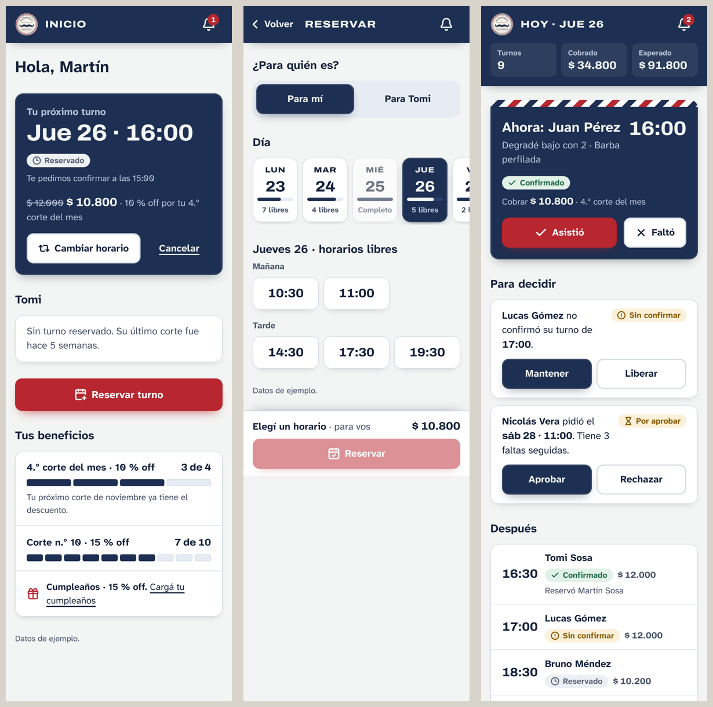
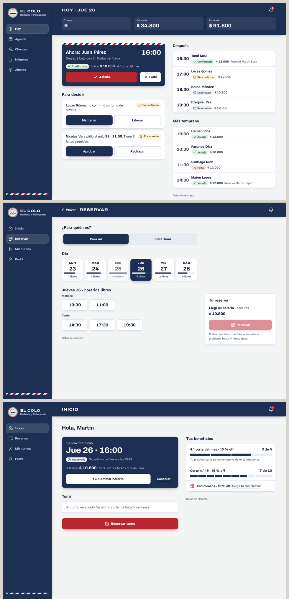
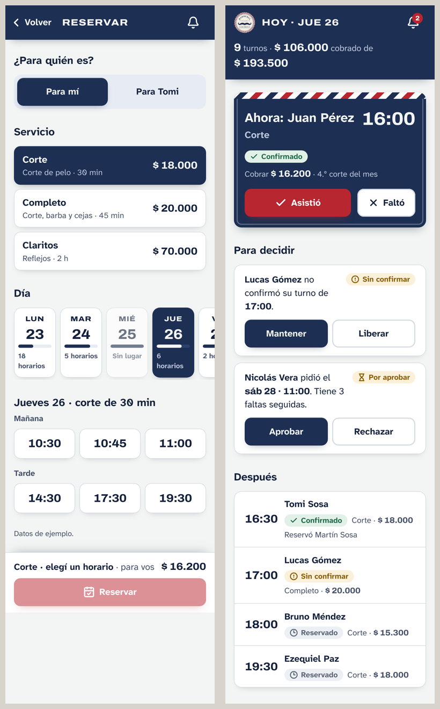
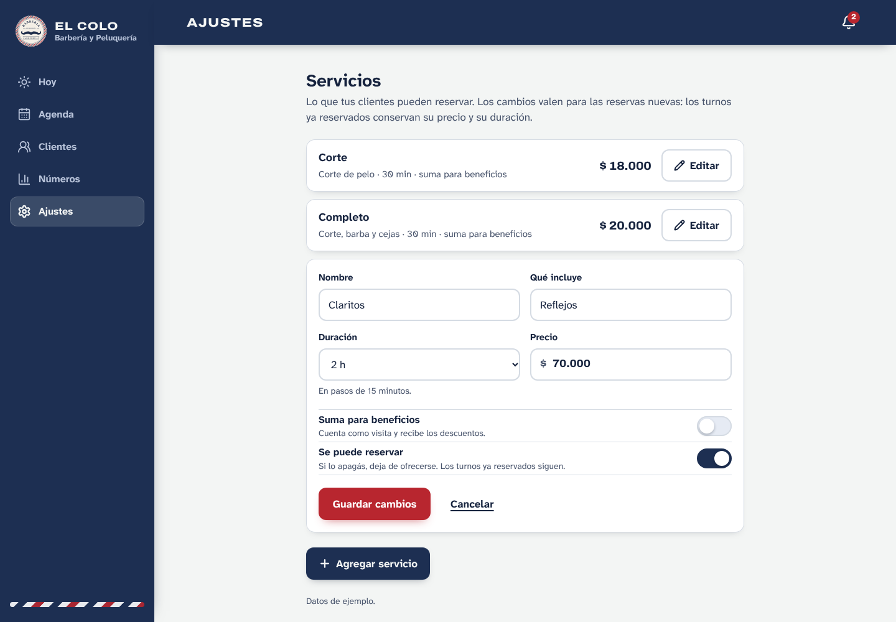
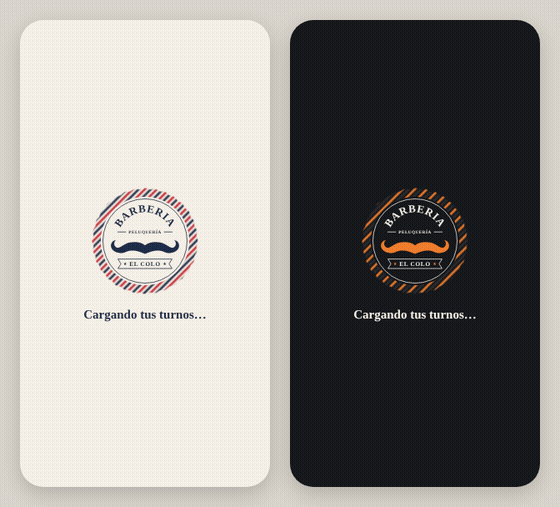

# Diseño 4 — Interfaz

Estado: aprobado (2026-11-20)
Parte de: Diseño → 1. Arquitectura ✅ · 2. Base de datos ✅ · 3. Backend ✅ · **4. Interfaz**
Entrada: [`PRODUCT.md`](../../PRODUCT.md) · Método: skill `impeccable`

> Decisiones de interfaz tomadas con el método de impeccable. El contrato de dirección vive en
> `.impeccable/surfaces/src-app.md`; el `DESIGN.md` se escribe al terminar, a partir de lo construido.

---

## UI-02. Dirección visual: chapa enlozada ✅

Elegida entre cuatro opciones (el turnero sorteado, chapa enlozada, el subte y el estándar de la
categoría). Los carteles esmaltados del barrio en los colores del poste de barbero.

| Aspecto | Definición |
|---|---|
| Superficies | Fondo blanco porcelana frío; **chapas** azul esmalte (estructura, lo importante, la selección) y chapas blancas (contenido), esquinas de 14 px, borde interior claro en las de esmalte |
| Color | Tres voces que no se mezclan: **esmalte azul** (marca y estructura), **rojo poste** (solo la acción principal de la pantalla y lo crítico), **estados** (verde, ámbar, rojo, gris) solo cuando el dato es un estado |
| Estados | Color + ícono + palabra (`StatusMark`): nunca solo color |
| Tipografía | **Archivo** ensanchada en mayúsculas espaciadas para las letras de chapa y en cifras tabulares para horarios y montos; **Atkinson Hyperlegible Next** para el texto (diseñada para baja visión). Texto base de 17 px |
| Controles | Estándar (radios, botones, navegación inferior), 52 a 56 px de alto, foco visible en rojo poste |
| Gesto distintivo | **El poste**: rayas que avanzan como un poste girando, solo en la carga, la confirmación de una reserva y el turno "ahora" del barbero |
| Tema | Claro de día (luz del local, calle); oscuro según el sistema, con la misma estructura |

**Web (≥ 1024 px):** la barra inferior pasa a ser un **riel lateral de esmalte** con la insignia, el
nombre y las secciones (con el poste al pie), y cada pantalla usa el ancho en dos columnas: el barbero ve
"Ahora" y "Para decidir" a la izquierda y la fila del día a la derecha; la reserva lleva el resumen
fijo a la derecha; el inicio del cliente pone los beneficios al costado. Mismo mundo, mismos componentes.

**Prototipo navegable** (datos de ejemplo): `/prototipo`, `/prototipo/cliente`, `/prototipo/reservar`
(con el flujo completo hasta la confirmación) y `/prototipo/barbero`. Los componentes base quedan en
`src/ui/` y se reutilizan en las specs.

**Servicios (D-10):** la reserva suma el paso "Servicio" (Corte, Completo, Claritos) con descripción,
duración y precio; los días y horarios se calculan para el servicio elegido, y Claritos avisa que no
suma para beneficios. En la vista del barbero, cada turno muestra su servicio (no la descripción del corte).

**Ajustes → Servicios** (`/prototipo/ajustes`): el barbero edita nombre, qué incluye, duración (en pasos de 15 min), precio, si suma para beneficios y si se puede reservar, y agrega servicios nuevos. Los cambios valen para reservas nuevas.

**Dependencias nuevas:** `@fontsource-variable/archivo` y `@fontsource-variable/atkinson-hyperlegible-next`
(fuentes autoalojadas: el build no depende de la red) y `lucide-react` (un solo sistema de íconos).

**Cierre:** aprobada por el dueño del proyecto; revisión final de impeccable en [`revision-impeccable.md`](revision-impeccable.md) (4 correcciones aplicadas, veredicto *ship*); sistema documentado en [`DESIGN.md`](../../DESIGN.md) con la estrella del norte "La chapa del barrio" y su anexo `.impeccable/design.json`.

## UI-01. Pantalla de carga con el logo ✅

**Pedido:** usar el logo de El Colo en los momentos de carga, como hace Corralap.

**Decisión:** el **borde de poste de barbero del logo gira** y **el bigote se mueve** una vez por vuelta, como el cartel giratorio de la puerta
de una barbería, mientras el resto del centro ("BARBERIA", "EL COLO") queda quieto. Es la misma idea que
Corralap, donde una parte del logo se anima en lugar de usar un indicador genérico, pero con el
elemento más reconocible de este logo.

| Aspecto | Definición |
|---|---|
| Archivos | `public/brand/loader-el-colo.svg` (claro) y `public/brand/loader-el-colo-oscuro.svg` (oscuro). SVG autónomos con su animación CSS adentro |
| Movimiento | Rotación continua del borde, una vuelta cada 2,4 s, velocidad constante. Entrada de 320 ms (aparece y escala de 94 % a 100 %) |
| Bigote | Una vez por vuelta hace un "tic": se tuerce a un lado (−6°), al otro (+5°) y vuelve, con un leve estiramiento, en el último tercio de la vuelta (entre el 62 % y el 92 %). El resto del tiempo queda quieto, para no competir con el giro |
| Movimiento reducido | Con `prefers-reduced-motion` el logo queda quieto, borde y bigote incluidos (constitución y `PRODUCT.md`) |
| Tamaño | 132 px en pantalla completa; nunca menos de 96 px (debajo de eso el texto del logo no se lee) |
| Texto | Debajo del logo, una línea corta según el contexto: "Cargando tus turnos…", "Cargando la agenda…". Siempre presente para lectores de pantalla (`role="status"`, `aria-live="polite"`) |
| Tema | Versión clara sobre fondo crema; oscura sobre fondo oscuro |

**Dónde se usa:**
- `app/loading.tsx` y los `loading.tsx` de cada sección (cambio de pantalla).
- La vuelta del login con Google (`auth/callback`) mientras se crea o carga el cliente.
- El primer arranque de la app instalada, mientras se carga la sesión.

**Dónde no se usa:** cargas chicas dentro de una pantalla (un botón que guarda, una lista que se
actualiza). Ahí van indicadores livianos (el botón en estado "guardando", esqueletos de la lista),
para no tapar la pantalla con el logo cada vez.

**Implementación:** un componente `BrandLoader` en `src/ui/brand/` que inserta el SVG en la página
(no como ``, para que tome el tema y la accesibilidad del componente). Entra con la primera spec
que tenga interfaz.

**Pendiente con la tipografía:** el texto del logo usa una slab de sistema como aproximación. Cuando
se elija la tipografía de la app, los textos del logo se pasan a trazos para que se vea igual en
todos los celulares.
