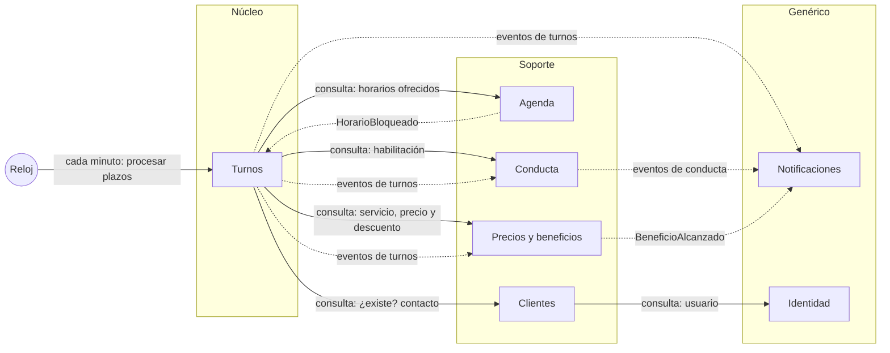
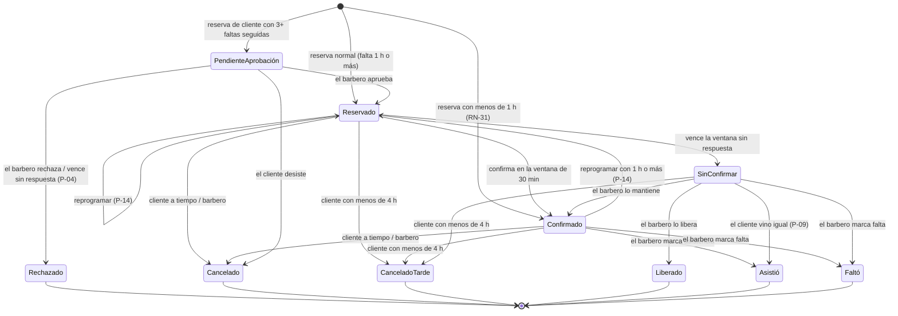

# Modelo de dominio — barber-colo

Estado: aprobado (2026-11-20)
Origen: [`docs/analisis.md`](analisis.md) (RN-x, RF-x, RNF-x)

> Modelo conceptual, independiente de la tecnología. Define **qué cosas existen en el negocio, qué reglas
> las protegen y cómo se comunican**. El diseño (base de datos, backend, interfaz) se hace a partir de
> este documento y no puede contradecirlo.

---

## 1. Criterio de modularización

**Alta cohesión.** Cada módulo agrupa un solo tema del negocio, es dueño de sus datos y de sus reglas,
y es el único que puede modificarlos. Si una regla cambia (por ejemplo, el umbral de faltas), cambia un
solo módulo.

**Bajo acoplamiento.** Los módulos se comunican de dos formas, y nunca leyendo ni escribiendo los datos
de otro:

| Forma | Cuándo | Ejemplo |
|---|---|---|
| **Consulta** (pregunta síncrona a través de una interfaz que define el que pregunta) | El que pregunta necesita la respuesta para decidir **ahora** | Turnos pregunta a Conducta: "¿este cliente puede reservar?" |
| **Evento de dominio** (aviso de algo que ya pasó) | Otros módulos tienen que **reaccionar**, pero el emisor no depende de ellos | Turnos publica `AsistenciaRegistrada`; Conducta y Precios reaccionan |

Regla: **un módulo no conoce a sus suscriptores**. Turnos no sabe que existe Notificaciones; solo
publica eventos.

## 2. Módulos (contextos)

| # | Módulo | Tipo | Responsabilidad (una sola) | Dueño de |
|---|---|---|---|---|
| 1 | **Turnos** | Núcleo | El ciclo de vida de un turno y sus plazos | Turno, Política de turnos |
| 2 | **Agenda** | Soporte | Cuándo atiende el barbero y qué horarios se ofrecen | Agenda, Franjas, Bloqueos |
| 3 | **Clientes** | Soporte | Quién se atiende, de qué cuenta depende y cómo se lo contacta | Cliente (persona atendida) |
| 4 | **Conducta** | Soporte | Faltas seguidas y si un cliente puede reservar | Ficha de conducta, Política de faltas |
| 5 | **Precios y beneficios** | Soporte | Qué servicios hay, cuánto cuestan y duran, y qué descuento corresponde | Servicio, Reglas de beneficio, Visitas computables |
| 6 | **Notificaciones** | Genérico | Entregar avisos al celular y dentro de la app | Suscripciones, Notificaciones |
| 7 | **Identidad** | Genérico | Quién inicia sesión y con qué rol | Usuario (lo resuelve el proveedor de login) |
| 8 | **Estadísticas** | Modelo de lectura | Indicadores, inicio del día y ficha 360 del barbero. Solo lee; nadie depende de él | Nada (ver [`estadisticas-crm.md`](estadisticas-crm.md)) |

El **reloj** no es un módulo del dominio: es un disparador externo que cada minuto le dice a Turnos
"ahora son las HH:MM" para que procese sus plazos (sección 7).

### Mapa de contextos

Líneas llenas: consultas (el que pregunta depende de una interfaz que él mismo define).
Líneas punteadas: eventos (el emisor no conoce al receptor).

## 3. Lenguaje ubicuo (glosario)

Estos términos se usan igual en la interfaz, en las specs y en el código (en inglés entre paréntesis).

| Término | Definición |
|---|---|
| **Turno** (`Appointment`) | Reserva de un horario concreto para un cliente. Tiene un estado y un historial. |
| **Horario** (`Slot`) | Bloque de tiempo con un inicio y un fin. Su largo depende del servicio. Es un valor, no una entidad. |
| **Paso de la agenda** | Cada cuántos minutos puede empezar un turno (por ejemplo, 15: 10:00, 10:15, 10:30…). |
| **Agenda** (`Schedule`) | Configuración de cuándo atiende el barbero: franjas semanales, paso de la agenda y bloqueos. |
| **Franja** (`WeeklyRange`) | Día de la semana con hora de inicio y fin de atención (puede haber varias por día). |
| **Bloqueo** (`Block`) | Rango de fecha y hora en el que no se atiende, aunque caiga dentro de una franja. |
| **Horario ofrecido** | Horario que surge de la agenda, no está bloqueado y respeta la anticipación mínima y máxima. |
| **Horario libre** | Horario ofrecido que no tiene un turno activo. |
| **Turno activo** | Turno en estado PendienteAprobación, Reservado, Confirmado o SinConfirmar. Ocupa el horario. |
| **Pedido de confirmación** | Aviso que se envía 1 h antes del turno pidiendo confirmar. |
| **Ventana de confirmación** | Los 30 min posteriores al pedido de confirmación. |
| **Turno sin confirmar** | Turno cuya ventana venció sin respuesta. Espera la decisión del barbero. |
| **Liberar** | Decisión del barbero de dejar libre el horario de un turno sin confirmar. |
| **Cancelación a tiempo / tarde** | Cancelación del cliente con 4 h o más / con menos de 4 h de anticipación. |
| **Margen de arrepentimiento** | Los 10 min posteriores a reservar, en los que cancelar nunca cuenta como tarde. |
| **Falta** | Turno marcado por el barbero como "no asistió". |
| **Faltas seguidas** | Faltas sin ninguna asistencia en el medio. Vuelven a cero con una asistencia. |
| **Habilitación** (`BookingEligibility`) | Si un cliente puede reservar: `normal`, `requiere aprobación` o `bloqueado`. |
| **Servicio** (`Service`) | Lo que se reserva: Corte, Completo (corte, barba y cejas) o Claritos. Tiene descripción, duración, precio y si suma para beneficios. |
| **Precio base** | Precio del servicio congelado en el turno al momento de reservar. |
| **Beneficio** (`Benefit`) | Regla de descuento: "el N.º corte del mes" o "cada N cortes". |
| **Visita computable** | Turno marcado como Asistió. Es lo único que cuenta para beneficios. |
| **Liquidación** (`Settlement`) | Foto del precio de un turno asistido: precio base, descuentos aplicados y precio final. |
| **Progreso** | Cuánto le falta a un cliente para cada beneficio (por ejemplo, "7 de 10"). |
| **Enlace de turno** (`AppointmentLink`) | Dirección secreta para que alguien sin cuenta vea, confirme o cancele un turno. |
| **Cliente** (`Customer`) | **Persona que se atiende** (la que se corta el pelo). Tiene su propio historial, faltas y beneficios. |
| **Titular** (`AccountHolder`) | Cliente dueño de una cuenta de Google. Reserva para sí y para sus personas a cargo, y recibe todas las notificaciones. |
| **Persona a cargo** (`Dependent`) | Cliente sin cuenta propia que pertenece a la cuenta de un titular (por ejemplo, un hijo). Solo tiene nombre y, opcionalmente, cumpleaños. |
| **Cliente con cuenta / sin cuenta** | Cliente que pertenece a una cuenta (titular o persona a cargo) / que solo cargó el barbero (nombre y teléfono). |
| **Vincular** | Unir el historial de un cliente sin cuenta con el de un cliente con cuenta. |

## 4. Diagrama de clases del dominio

```mermaid
classDiagram
    direction LR

    namespace Turnos {
        class Appointment {
            <<aggregate root>>
            id
            customerId
            serviceId
            slot : Slot
            status : AppointmentStatus
            origin : app | manual
            basePrice : Money
            bookedAt : Instant
            confirmationRequestedAt : Instant?
            reminderSentAt : Instant?
            rescheduleCount : int
            settlement : Settlement?
            cancellationReason?
            link : AppointmentLink?
            approve()
            reject()
            requestConfirmation(now)
            confirm(now)
            expireConfirmation(now)
            keep()
            release()
            cancelByCustomer(now, policy)
            cancelByBarber(reason)
            reschedule(newSlot, now, actor, reason?)
            markAttended(now, settlement)
            markNoShow(now)
        }
        class StatusChange {
            <<entity>>
            from
            to
            actor
            at : Instant
            reason?
        }
        class AppointmentPolicy {
            <<value object>>
            cancelNotice : 4h
            confirmationLead : 1h
            confirmationWindow : 30m
            undoWindow : 10m
            reminderTime : 20:00
        }
        class AppointmentLink {
            <<value object>>
            token
            expiresAt
        }
        class Settlement {
            <<value object>>
            basePrice : Money
            discounts : AppliedDiscount[]
            finalPrice : Money
            paymentMethod?
        }
    }

    namespace Agenda {
        class Schedule {
            <<aggregate root>>
            step : Duration
            minNotice : 30m
            maxAdvance : 30d
            offeredSlots(range, now, duration) Slot[]
        }
        class WeeklyRange {
            <<value object>>
            weekday
            from : LocalTime
            to : LocalTime
        }
        class Block {
            <<entity>>
            from : Instant
            to : Instant
            reason
        }
    }

    namespace Clientes {
        class Customer {
            <<aggregate root>>
            id
            name
            phone : Phone
            accountUserId?
            role : holder | dependent | manual
            linkedTo?
            acquisitionSource?
            notes?
            birthDayMonth?
            linkTo(customer)
            addDependent(name)
            anonymize()
        }
    }

    namespace Conducta {
        class ConductRecord {
            <<aggregate root>>
            customerId
            consecutiveNoShows : int
            manuallyBlocked : bool
            eligibility(policy) BookingEligibility
            registerAttendance()
            registerNoShow()
            block()
            unblock()
        }
        class NoShowPolicy {
            <<value object>>
            approvalThreshold : 3
        }
    }

    namespace PreciosYBeneficios {
        class Service {
            <<aggregate root>>
            id
            name
            description
            duration : Duration
            price : Money
            countsForBenefits : bool
            active : bool
        }
        class BenefitRule {
            <<aggregate root>>
            id
            kind : NTH_IN_MONTH | EVERY_NTH | BIRTHDAY
            n : int
            discount : Percentage
            deactivatedAt?
        }
        class CountableVisit {
            <<entity>>
            customerId
            appointmentId
            localDate
        }
    }

    namespace Notificaciones {
        class PushSubscription {
            <<entity>>
            userId
            endpoint
            keys
        }
        class Notification {
            <<aggregate root>>
            recipient
            kind
            payload
            status : pending | sent | failed | read
            attempts : int
        }
    }

    class Slot {
        <<value object>>
        start : Instant
        end : Instant
    }
    class Money {
        <<value object>>
        cents : int
    }

    Appointment "1" *-- "many" StatusChange : historial
    Appointment *-- Settlement
    Appointment *-- AppointmentLink
    Appointment --> Slot
    Appointment ..> AppointmentPolicy : aplica
    Schedule "1" *-- "many" WeeklyRange
    Schedule "1" *-- "many" Block
    Schedule ..> Slot : genera
    ConductRecord ..> NoShowPolicy : aplica
```

> Las flechas entre módulos son **por identificador** (`customerId`, `appointmentId`), nunca por
> referencia directa: así cada módulo puede cambiar su modelo interno sin romper a los demás.

## 5. Agregados e invariantes

Un **agregado** es el límite de consistencia: todo lo que está adentro se modifica junto y sus reglas
se cumplen siempre. Entre agregados, la consistencia es eventual (vía eventos).

| Agregado | Invariantes (siempre verdaderas) | Reglas |
|---|---|---|
| **Turno** | I-1. Solo se pasa de un estado a otro por las transiciones del diagrama 6.  I-2. **Un horario tiene como máximo un turno activo.**  I-3. Un cliente tiene como máximo **un turno futuro activo**.  I-4. El precio base no cambia después de reservar.  I-5. Asistencia o falta solo se marcan a partir del inicio del turno.  I-6. La liquidación existe si y solo si el estado es Asistió.  I-7. Todo cambio de estado o de horario deja un registro con actor y fecha.  I-7b. Un turno se reprograma como máximo [2] veces por el cliente. | RN-03, RN-05, RN-06b, RN-07 a RN-11, RN-31 a RN-33, RNF-13 |
| **Agenda** | I-8. Las franjas de un mismo día no se superponen.  I-9. El paso de la agenda es mayor que cero y divide la hora en partes iguales (5, 10, 15, 20, 30 o 60 min). | RN-01, RN-02, RN-04, RN-30 |
| **Cliente** | I-10. El teléfono está normalizado (formato internacional) y es único entre clientes no vinculados. Lo tienen el titular y los clientes manuales; las personas a cargo usan el del titular.  I-11. Un cliente vinculado no puede volver a vincularse.  I-17. Una cuenta tiene exactamente un titular y hasta [5] personas a cargo.  I-18. Una persona a cargo no tiene cuenta, email ni teléfono propios. | RF-14, RF-18, RNF-07, P-16 |
| **Ficha de conducta** | I-12. Las faltas seguidas nunca son negativas y vuelven a cero con una asistencia.  I-13. La habilitación se **calcula**, no se guarda: bloqueado manual > faltas ≥ umbral > normal. | RN-12 a RN-17 |
| **Regla de beneficio** | I-14. N ≥ 1 (salvo BIRTHDAY) y descuento entre 1 % y 100 %.  I-14b. BIRTHDAY se aplica como máximo una vez por cliente y año.  I-15. Desactivar una regla no altera liquidaciones pasadas. | RN-18 a RN-23, RF-33 |
| **Servicio** | I-16. Duración mayor que cero y múltiplo del paso de la agenda; precio mayor que cero; nombre único entre los activos. | RN-06, RN-35 a RN-39 |

## 6. Ciclo de vida del Turno (actualizado)

El modelado mostró un estado que faltaba en el análisis: la reserva de un cliente con 3 faltas seguidas
**espera la aprobación del barbero** (RN-16), y mientras tanto ocupa el horario.

| Grupo | Estados | ¿Ocupa el horario? |
|---|---|---|
| Activos | PendienteAprobación, Reservado, Confirmado, SinConfirmar | Sí |
| Finales | Rechazado, Cancelado, CanceladoTarde, Liberado, Asistió, Faltó | No (Asistió y Faltó quedan en el pasado) |

## 7. Eventos de dominio

| Evento | Emisor | Datos | Quién reacciona y para qué |
|---|---|---|---|
| `AppointmentBooked` | Turnos | turno, cliente, horario, estado inicial | Notificaciones: aviso al barbero (y al cliente si nace Confirmado) |
| `AppointmentApprovalRequested` | Turnos | turno, cliente | Notificaciones: pedir decisión al barbero |
| `AppointmentApproved` / `AppointmentRejected` | Turnos | turno, motivo | Notificaciones: aviso al cliente |
| `DayBeforeReminderDue` | Turnos | turno | Notificaciones: recordatorio simple al cliente |
| `ConfirmationRequested` | Turnos | turno, vence a las | Notificaciones: pedido con acciones Confirmar/Cancelar |
| `AppointmentConfirmed` | Turnos | turno | Notificaciones: aviso al barbero |
| `ConfirmationExpired` | Turnos | turno | Notificaciones: pedir decisión al barbero (Mantener/Liberar) |
| `AppointmentReleased` | Turnos | turno | Notificaciones: aviso al cliente |
| `AppointmentCancelled` | Turnos | turno, por quién, ¿tarde?, motivo | Notificaciones: aviso a la otra parte (con el motivo si canceló el barbero) |
| `AppointmentRescheduled` | Turnos | turno, horario anterior y nuevo, por quién, ¿tarde?, motivo | Notificaciones: aviso a la otra parte |
| `AttendanceRegistered` | Turnos | turno, cliente, fecha local, ¿asistió?, liquidación | Conducta: suma o resetea faltas. Precios: registra la visita computable |
| `NoShowThresholdReached` | Conducta | cliente | Notificaciones: aviso al cliente de la política |
| `BenefitReached` | Precios | cliente, beneficio | Notificaciones: "tu próximo corte tiene X % off" |
| `SlotBlocked` | Agenda | rango | Turnos: cancela por barbero los turnos activos del rango |

**Garantía de entrega.** Un evento se registra en la misma operación que el cambio que lo produce
(si el cambio se guarda, el evento también) y se procesa después, con reintentos. Así un fallo en las
notificaciones nunca deja un turno a medio cambiar (RNF-10).

## 8. Servicios de dominio (lógica pura)

Funciones sin estado ni acceso a datos, que reciben todo por parámetro (constitución, principio 3).
Son el centro de los tests.

| Servicio | Módulo | Entrada → salida |
|---|---|---|
| `offeredSlots` | Agenda | agenda, rango de días, ahora, duración del servicio → inicios donde el servicio entra completo |
| `freeSlots` | Turnos | horarios ofrecidos, turnos activos → horarios libres |
| `initialStatus` | Turnos | horario, ahora, habilitación, política → PendienteAprobación / Reservado / Confirmado |
| `cancellationKind` | Turnos | turno, ahora, política → a tiempo / tarde (vale también para reprogramar) |
| `dueActions` | Turnos | turnos activos, ahora, política → recordatorios, pedidos y vencimientos que corresponden ahora |
| `eligibility` | Conducta | ficha, política → normal / requiere aprobación / bloqueado |
| `applicableDiscounts` | Precios | servicio, visitas previas del cliente, fecha local del turno, reglas activas → descuentos (ninguno si el servicio no suma para beneficios) |
| `settle` | Precios | precio base, descuentos → liquidación (suma de porcentajes, redondeo a centavos) |
| `isBirthdayWeek` | Precios | fecha de nacimiento (día y mes), fecha local del turno, parámetros → sí / no (cuidado con fin de año y 29/2) |
| `benefitProgress` | Precios | visitas del cliente, hoy, reglas → progreso por beneficio |
| `customerHealth` | Clientes | visitas del cliente, ¿turno futuro?, hoy, parámetros → al día / se enfría / perdido (P-13) |

**Simplificación que surge del modelo:** el progreso mensual **no se reinicia con una tarea programada**
(RF-31). Se calcula contando las visitas computables del mes en curso; el 1.º de cada mes el conteo da
cero solo.

## 9. Decisiones del modelado

| Id | Decisión |
|---|---|
| P-04 ✅ | Si el barbero no aprueba ni rechaza una reserva pendiente antes del pedido de confirmación (1 h antes), se rechaza sola y se avisa al cliente. A un cliente que requiere aprobación solo se le ofrecen horarios a [2 h] o más. |
| P-05 ✅ | El barbero puede cancelar un turno sin consecuencias para el cliente. **Escribe obligatoriamente el motivo**, que le llega al cliente en la notificación. |
| P-06 ✅ | El barbero puede corregir una marca de asistencia (Asistió ↔ Faltó) hasta **[48 h]** después. Se recalculan faltas seguidas y visitas computables, y queda en el historial. |
| P-07 ✅ | **Hay reprogramación desde la primera versión** (reglas en P-14). |
| P-08 ✅ | Al cargar un turno a mano, el barbero busca al cliente por **nombre o teléfono** y solo crea uno nuevo si no existe. |
| P-09 ✅ | Si un turno quedó SinConfirmar y el cliente vino igual, el barbero puede marcar Asistió directamente. |

## 10. Reglas nuevas (aprobadas)

### P-14 ✅ Reprogramación

Reprogramar es **mover el mismo turno** a otro horario libre: conserva su historial, su precio base y su
enlace. No es cancelar y reservar de nuevo.

- **Quién**: el cliente (desde la app o el enlace) y el barbero.
- **Cuándo**: mientras el turno esté activo y no haya empezado.
- **Plazo**: con [4 h] o más de anticipación (o dentro del margen de 10 min posterior a reservar) no
  queda registro. Con menos de 4 h queda registrado como **reprogramación tarde**, igual que una
  cancelación tarde: se ve en la ficha y no suma faltas.
- **Límite**: hasta [2] reprogramaciones por turno; después hay que cancelar y reservar.
- **Estado después de mover**: se recalcula como si fuera una reserva nueva (`initialStatus`). Un turno
  Confirmado vuelve a Reservado y recibe otra vez el recordatorio y el pedido de confirmación; si el
  nuevo horario es en menos de 1 h, queda Confirmado. Un turno PendienteAprobación sigue pendiente.
- **Precio**: se mantiene el precio base original.
- **Reprogramación del barbero**: como en P-05, escribe el motivo y al cliente le llega una
  notificación con el nuevo horario. No cuenta como reprogramación tarde ni consume el límite del cliente.
- **Aviso al barbero**: toda reprogramación del cliente le envía una notificación al barbero con el
  cliente, el horario anterior, el nuevo y si fue tarde (por ejemplo: "Juan pasó su turno del jueves
  16:00 al viernes 11:00").
- Evento: `AppointmentRescheduled` (horario anterior, horario nuevo, por quién, ¿tarde?).
  Notificaciones avisa a la otra parte. Las tardías quedan en el historial del turno y se ven en la ficha del cliente.

### P-15 ✅ Descuento de cumpleaños

- Nuevo tipo de beneficio **BIRTHDAY**: [15 %] en un corte cuya fecha caiga en la **semana del
  cumpleaños** (de [3] días antes a [3] días después), **una vez por año**.
- Requiere que el cliente haya cargado día y mes de nacimiento (P-12).
- Se suma a los otros descuentos (D-05).
- El cliente recibe una notificación al empezar esa semana con el enlace para reservar.

### P-16 ✅ Reserva para personas a cargo

Muchos clientes son chicos que van con sus padres. Un **titular** (el adulto con cuenta de Google)
puede cargar en su cuenta hasta [5] **personas a cargo** y reservar para ellas.

- **Cada persona es un cliente** con su propio historial, faltas seguidas, beneficios y cumpleaños
  (un chico también puede tener descuento de cumpleaños).
- **Un turno futuro activo por persona**, no por cuenta (I-3): el padre puede reservar su turno y el
  de su hijo, incluso en horarios seguidos.
- **Las notificaciones** de los turnos de una persona a cargo le llegan al titular, y el texto dice
  para quién es ("¿Confirmás el turno de Tomi de hoy a las 16:00?").
- **Habilitación por persona:** las faltas de un chico no restringen al padre, y al revés. Si el
  barbero bloquea al titular, sus personas a cargo tampoco pueden reservar desde esa cuenta.
- **Datos mínimos:** de una persona a cargo solo se guardan el nombre y, opcionalmente, el día y mes
  de cumpleaños. No tiene teléfono ni email propios (los del titular sirven para el contacto).
- **Vinculación:** si el barbero tenía cargado a mano a ese chico, puede vincularlo a la cuenta del
  titular, igual que con cualquier cliente manual (RF-18).
- **Baja:** el titular puede quitar una persona a cargo (se anonimiza, como cualquier cliente). Si el
  titular pide la baja de su cuenta, se anonimizan también sus personas a cargo.

### D-10 ✅ Servicios con precio y duración propios

El barbero tiene tres servicios con turno: **Corte** ($ 18.000), **Completo** (corte, barba y cejas,
$ 20.000) y **Claritos** ($ 70.000), cada uno con la duración que él define. Las **ceras** son un
producto del local y no entran en los turnos.

- **Agenda:** pasa de "bloques fijos" a un **paso** [15 min]: un turno puede empezar en cualquier
  múltiplo del paso donde su servicio entre completo. Turnos de distinta duración nunca se superponen.
- **Reserva:** el cliente elige primero el servicio; los horarios que ve dependen de su duración.
  El turno guarda el servicio, su precio y su fin.
- **Beneficios:** solo Corte y Completo suman visitas y reciben descuentos (también el de cumpleaños).
  Un Claritos no suma ni se descuenta.
- **Estadísticas:** se suma la vista por servicio (facturación y cantidad), como el catálogo de Corralap.

### P-17 ✅ Cambio de servicio al marcar asistencia

Si el cliente reservó Corte y en el sillón pide Completo, el barbero puede **cambiar el servicio al
marcar Asistió**. El precio base pasa a ser el del servicio nuevo en ese momento (excepción a D-09,
porque el cambio lo pide el cliente) y queda en el historial. Si el nuevo servicio dura más y choca con
el turno siguiente, el sistema lo avisa, pero no lo impide: el turno ya está ocurriendo.
