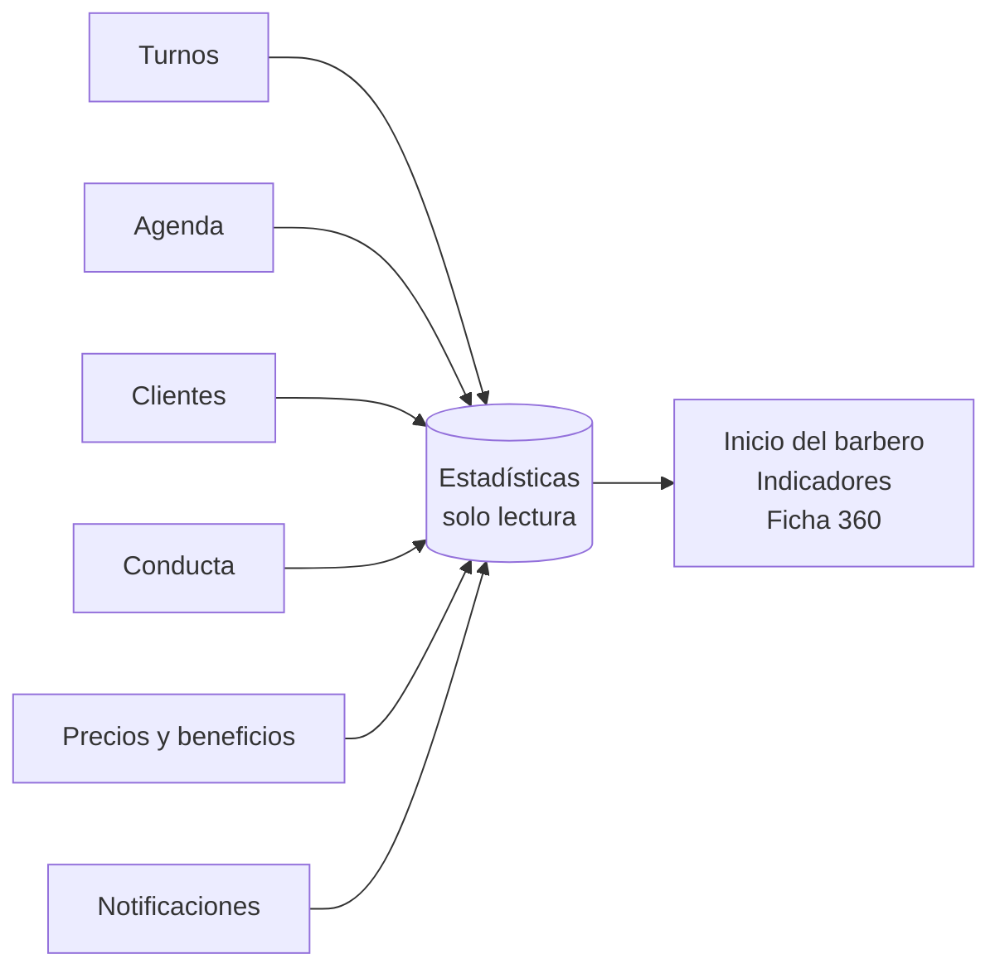

# Estadísticas y CRM del barbero — barber-colo

Estado: aprobado (P-10 a P-13), 2026-11-20
Modelo: [`docs/dominio.md`](dominio.md) · Referencia: Corralap ([app](https://corralap.vercel.app), repo `EloSanz/crm-web-app`)

> El barbero no solo gestiona turnos: maneja un negocio. Este módulo le muestra cuánta plata entra,
> cuánto trabaja, qué clientes vuelven y a quién conviene escribirle hoy. Toma la forma de los
> indicadores de Corralap y la adapta a una barbería de una persona.

---

## 1. Qué tomamos de Corralap (y qué no)

| De Corralap | En barber-colo | Por qué |
|---|---|---|
| Servicio de indicadores **de solo lectura** que junta datos de todos los módulos y nunca escribe | Módulo **Estadísticas** como modelo de lectura: lee, no modifica | Alta cohesión: calcular métricas es un tema aparte. Bajo acoplamiento: ningún módulo depende de él |
| Selector de período (30/90/180/365) y **comparación con el período anterior** en cada cifra | Períodos **7/30/90/365** días (la semana importa en una barbería) | Misma forma, otro ritmo de negocio |
| Granularidad automática (semana hasta 90 días, mes después) | Día hasta 30 días, semana hasta 90, mes después | Con 7 días, agrupar por semana deja una sola barra |
| Pestañas: Ventas, Vendedores, Etapas, Presupuestos, Clientes, Obras, Contacto, Catálogo | Pestañas: **Facturación, Agenda, Asistencia, Clientes, Servicios, Canales, Beneficios** | Un solo barbero y un solo servicio: no hay vendedores, etapas ni catálogo |
| Patrón por pestaña: cifras clave arriba → series por período con **"Ver tabla"** → rankings → desgloses → listado | Igual | Funciona en el celular y es accesible (cada gráfico tiene su tabla) |
| Cifra clave con variación: `%` para montos, **puntos porcentuales** para tasas, diferencia simple para cantidades | Igual | Comparar tasas en % de % confunde |
| "Sin datos" devuelve vacío, **nunca divide por cero** | Igual | Una barbería nueva arranca sin historial |
| Semáforo de salud (al día / en riesgo / estancado) por días desde el último contacto, con umbrales fijos 7/14 | Semáforo por cliente **relativo a su propia frecuencia** (sección 4) | Un cliente que viene cada 15 días y otro cada 40 no se enfrían igual |
| "A quién llamar hoy" en el Inicio | **"A quién escribirle hoy"** con botón de WhatsApp y mensaje ya escrito | Es la acción de CRM más rentable para un barbero |
| "Ponete al día" con un cliente (resumen de su historia) | **Ficha 360 del cliente** (sección 5), sin IA en v1 | Los datos ya están estructurados |
| Orígenes y motivos de pérdida como listas configurables | **Cómo nos conoció** y **motivo de cancelación**, configurables | Alimentan los desgloses |
| Auditoría de cambios | El historial de estados de cada turno (I-7) | Ya está en el modelo |
| Gráficos propios en SVG, paleta validada para daltonismo, tres "voces" de color (marca, selección, estado) | Se retoma en el diseño con la skill impeccable | Ver sección 8 |

**Lo que no repetimos:**
- Corralap carga **todos** los datos en memoria del backend y los cachea 20 s. Acá las métricas se calculan **en Postgres** (vistas y funciones), que escala y evita traer datos de más.
- Corralap arma los días y semanas en **UTC**. Acá cada agrupación se hace en la hora del local (constitución, principio 6): un corte a las 22:30 del lunes es del lunes.

## 2. Datos nuevos que hay que capturar

Para que las estadísticas digan algo, el modelo necesita algunos datos que hoy no tiene.

| Dato | Dónde | Cuándo se carga | Para qué |
|---|---|---|---|
| **Cómo nos conoció** (`acquisitionSource`) | Cliente | Al completar el perfil (una pregunta, opcional) o lo carga el barbero | Clientes por origen: saber si funciona Instagram, la recomendación o pasar por la puerta |
| **Notas del barbero** (`notes`) | Cliente | Cuando quiera, desde la ficha | CRM real: "degradé bajo con 2, barba perfilada, hincha de Racing" |
| **Motivo de cancelación** (`cancellationReason`) | Turno | Opcional al cancelar (lista corta) | Entender por qué se cancela |
| **Medio de pago** (`paymentMethod`) *(propuesta P-11)* | Liquidación | Al marcar Asistió (efectivo, transferencia, Mercado Pago) | Saber cuánto entra en efectivo y cuánto en el banco |
| **Fecha de nacimiento** *(propuesta P-12)* | Cliente | Opcional en el perfil | Saludo de cumpleaños y beneficio de cumpleaños (más adelante) |

Las listas de "cómo nos conoció" y "motivos de cancelación" son configurables por el barbero, como en
Corralap (valores iniciales: Instagram, recomendación de un amigo, pasé por la puerta, Google, otro /
no puedo ir, me surgió algo, me equivoqué de horario, otro).

## 3. Catálogo de indicadores

Período = últimos N días hasta ahora, en hora local. Período anterior = los N días previos.
"Facturado" = suma de precios finales de turnos **Asistió** (es lo que el barbero cobró; la app no
procesa pagos, así que es facturación registrada, no cobranza).

### 3.1 Inicio del barbero (hoy)

No depende del período: es la foto del día.

- **Turnos de hoy** en línea de tiempo, con el estado de cada uno.
- **Facturación esperada de hoy**: suma de precios (con descuento estimado) de los turnos activos de hoy, y cuánto ya se registró.
- **Pendientes de acción**: reservas por aprobar, turnos sin confirmar, turnos pasados sin marcar.
- **A quién escribirle hoy**: los clientes que "se enfrían" (sección 4), primero los más valiosos.

### 3.2 Facturación

| Indicador | Definición | Comparación |
|---|---|---|
| Facturado | Σ precio final de turnos Asistió en el período | % vs período anterior |
| Cortes | Cantidad de turnos Asistió | diferencia |
| Ticket promedio | Facturado / cortes | % |
| Descuentos otorgados | Σ (precio base − precio final) y % sobre el precio base | % y p. p. |
| Facturación agendada | Σ precio base de turnos activos futuros | — |
| Serie | Facturado y cortes por día / semana / mes | — |
| Desglose | Por servicio · por medio de pago · por día de la semana | — |

### 3.3 Agenda (ocupación)

| Indicador | Definición |
|---|---|
| Ocupación | Turnos Asistió / horarios ofrecidos en el período (ya pasados) |
| Horas trabajadas | Suma de las duraciones de los turnos Asistió |
| Mapa de calor día × hora | Reservas por franja (como el mapa de calor de etapas de Corralap): dónde hay demanda y dónde hay horas muertas |
| Anticipación de reserva | Mediana de horas entre la reserva y el turno; % de reservas para el mismo día |
| Horarios perdidos | Horarios que quedaron vacíos por falta, cancelación tarde o liberación |

### 3.4 Asistencia

| Indicador | Definición | Comparación |
|---|---|---|
| Tasa de asistencia | Asistió / (Asistió + Faltó) | p. p. |
| Faltas | Cantidad de Faltó | diferencia |
| Cancelaciones tarde | Cantidad de CanceladoTarde | diferencia |
| Tasa de confirmación | Confirmados dentro de la ventana / pedidos de confirmación enviados | p. p. |
| Sin confirmar | Cuántos pasaron a SinConfirmar y qué decidió el barbero (mantener / liberar) | — |
| Clientes con restricción | Cantidad con aprobación requerida y bloqueados (foto actual) | — |
| Motivos de cancelación | Ranking | — |

### 3.5 Clientes

| Indicador | Definición | Comparación |
|---|---|---|
| Clientes activos | Con al menos una visita en el período | diferencia |
| Clientes nuevos | Primera visita dentro del período | diferencia |
| Recurrentes | % de clientes activos con 2 o más visitas (en total) | p. p. |
| Frecuencia media | Mediana de días entre visitas de los clientes recurrentes | — |
| Retención | % de clientes nuevos del período anterior que volvieron en este | p. p. |
| Top clientes | Ranking por facturado y por visitas | — |
| Por origen | Clientes y facturado por "cómo nos conoció" | — |
| Por salud | Al día / se enfría / perdido (sección 4) | — |
| Listado | Nombre, visitas, facturado, última visita, próxima, salud | — |

### 3.5b Servicios

Como la pestaña Catálogo de Corralap, para los servicios de El Colo (D-10).

| Indicador | Definición |
|---|---|
| Por servicio | Cantidad, facturado y ticket de Corte, Completo y Claritos, con variación vs. el período anterior |
| Mezcla | Porcentaje de cada servicio sobre los turnos y sobre la facturación |
| Horas por servicio | Tiempo de agenda que ocupa cada servicio (Claritos ocupa mucho más por turno) |
| Facturación por hora | Facturado / horas ocupadas, por servicio: cuál rinde más el tiempo del barbero |

### 3.6 Canales

Mide el objetivo principal del proyecto: **sacar los turnos de WhatsApp**.

| Indicador | Definición |
|---|---|
| Reservas desde la app | % de turnos con origen app (objetivo del análisis: más del 80 % a los 2 meses) |
| Reservas manuales | % con origen manual, y cuántas se gestionaron por enlace |
| Notificaciones activas | % de clientes con push activado |
| Confirmaciones desde la notificación | % de confirmaciones hechas tocando la notificación |

### 3.7 Beneficios

| Indicador | Definición |
|---|---|
| Descuentos otorgados | Cantidad y monto por regla (4.º corte del mes, corte N.º 10, cumpleaños) |
| Costo de fidelización | Descuentos / facturado bruto (p. p.) |
| Clientes cerca de un beneficio | Les falta 1 corte (oportunidad de escribirles) |

## 4. Salud del cliente: "a quién escribirle hoy"

Corralap marca un presupuesto como estancado con umbrales fijos (7 y 14 días). En una barbería cada
cliente tiene su ritmo, así que el umbral se calcula **con su propia frecuencia**:

| Estado | Condición (sin turno futuro activo) |
|---|---|
| **Al día** | Tiene un turno futuro, o los días desde su última visita ≤ 1,2 × su frecuencia habitual |
| **Se enfría** | Entre 1,2 × y 2 × su frecuencia habitual |
| **Perdido** | Más de 2 × su frecuencia habitual, o más de [90] días sin venir |

- **Frecuencia habitual** = mediana de días entre sus visitas (necesita 3 visitas o más). Con menos
  visitas se usa la frecuencia media de todos los clientes recurrentes, y si todavía no hay datos, [30] días.
- La lista "A quién escribirle hoy" muestra los que **se enfrían**, ordenados por facturado histórico.
  Cada fila tiene un botón de WhatsApp con un mensaje ya escrito ("¡Hola Juan! Hace 5 semanas que no
  pasás, ¿te guardo un turno?") y el enlace para reservar.
- Igual que en Corralap, el semáforo siempre va con su etiqueta, nunca solo con color.

Es un **servicio de dominio puro** (`customerHealth(visitas, turnoFuturo, hoy, parámetros)`), con los
mismos tests de bordes que el resto.

## 5. Ficha 360 del cliente

Una sola vista con todo lo que el barbero necesita antes de atenderlo:

- **Cabecera**: nombre, teléfono (botón de WhatsApp), salud, cómo nos conoció, cliente desde.
- **Cifras**: visitas, facturado total, ticket promedio, frecuencia habitual, última y próxima visita.
- **Conducta**: faltas seguidas, cancelaciones tarde, estado (normal / requiere aprobación / bloqueado) con la acción para bloquear o desbloquear.
- **Beneficios**: barras de progreso y descuentos ya otorgados.
- **Notas del barbero** (preferencias del corte).
- **Historial de turnos** con estado, precio y quién hizo cada cambio.

## 6. Lugar en el modelo de dominio

Se suma como **módulo 8: Estadísticas**, de tipo *modelo de lectura*:

- **No tiene agregados ni reglas de negocio propias**: solo consultas sobre los datos de los demás módulos.
- **Nadie depende de él**: si se borra, el sistema sigue funcionando. Él depende de todos, solo para leer.
- Las notas del barbero, "cómo nos conoció" y el motivo de cancelación **no** son de Estadísticas: son
  datos de Clientes y de Turnos que Estadísticas lee.
- La salud del cliente es una función pura del módulo Clientes, que Estadísticas usa para la lista.

## 7. Casos de uso nuevos

| CU | Nombre | Actor | Módulo |
|---|---|---|---|
| CU-25 | Ver el inicio del día (turnos, facturación esperada, pendientes, a quién escribir) | Barbero | Estadísticas |
| CU-26 | Ver indicadores por período (6 pestañas) | Barbero | Estadísticas |
| CU-27 | Ver la ficha 360 de un cliente y editar sus notas | Barbero | Estadísticas + Clientes |
| CU-28 | Escribirle a un cliente que se enfría (WhatsApp con mensaje ya escrito) | Barbero | Clientes |
| CU-29 | Configurar listas (cómo nos conoció, motivos de cancelación) | Barbero | Clientes + Turnos |

Entran en una spec nueva, **010-estadisticas-crm**, después de la 008 (necesita datos de asistencia y
beneficios para mostrar algo útil). El inicio del día (CU-25) puede adelantarse a la 007, porque los
pendientes de acción son parte de la operación diaria.

## 8. Ideas de diseño para retomar (fase de diseño)

Del sistema de diseño de Corralap (`frontend/.impeccable/`), para usar como referencia con la skill impeccable, sin copiar la marca:

- **Contrato de dirección** (tesis, mundo propio, historia, primer vistazo) escrito antes de diseñar.
- **Tres voces de color** que no se mezclan: marca y acción principal / selección / estado.
- **Pocas palabras en pantalla**, cifras grandes, texto de 15 px como mínimo, objetivos táctiles de 44 px.
- **Gráficos propios en SVG** (barras, línea con área, barras apiladas, mapa de calor, cifra con mini línea), cada uno con leyenda y "Ver tabla"; paleta categórica validada para daltonismo; el color de marca nunca se usa en datos.
- **Conteo animado** de cifras y variaciones con flecha y texto, respetando `prefers-reduced-motion`.
- Barra inferior de navegación en el celular, como Corralap.

## 9. Decisiones

| Id | Decisión |
|---|---|
| P-10 ✅ | Módulo Estadísticas (solo lectura) con 6 pestañas, inicio del día, ficha 360 y "a quién escribirle hoy". Spec 010; el inicio del día se adelanta a la 007. |
| P-11 ✅ | Medio de pago opcional al marcar Asistió, con el último usado preseleccionado. |
| P-12 ✅ | Fecha de nacimiento opcional (día y mes) para el **descuento de cumpleaños** (regla en `dominio.md`, P-15). |
| P-13 ✅ | Salud del cliente relativa a su propia frecuencia. |
