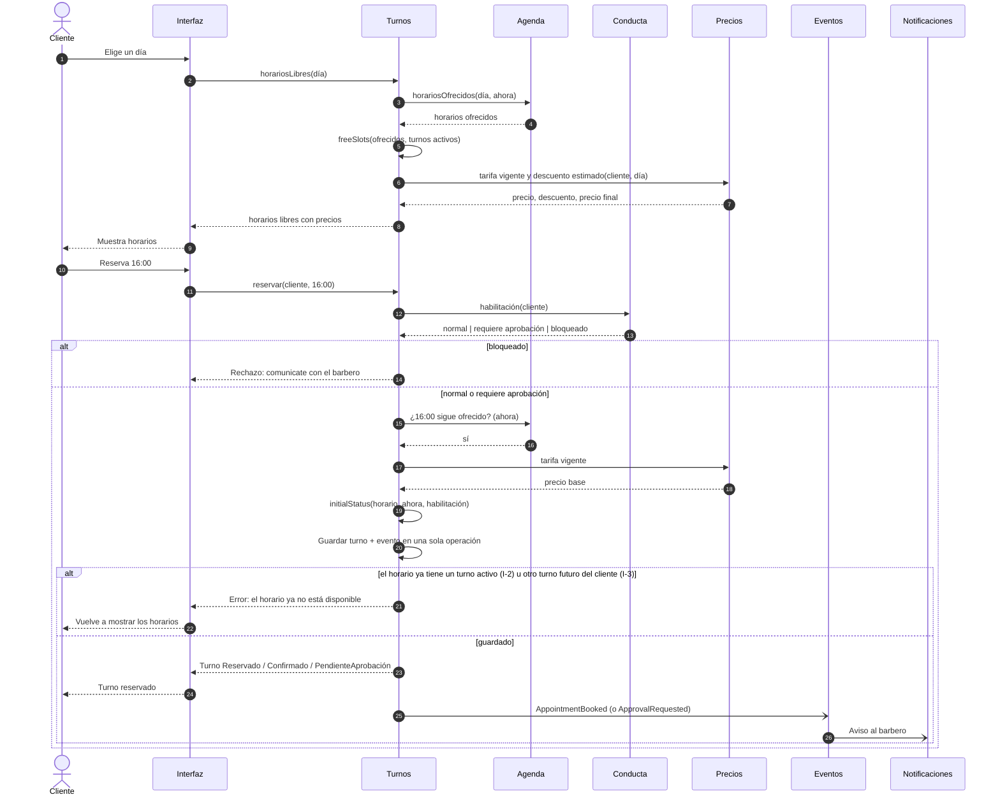
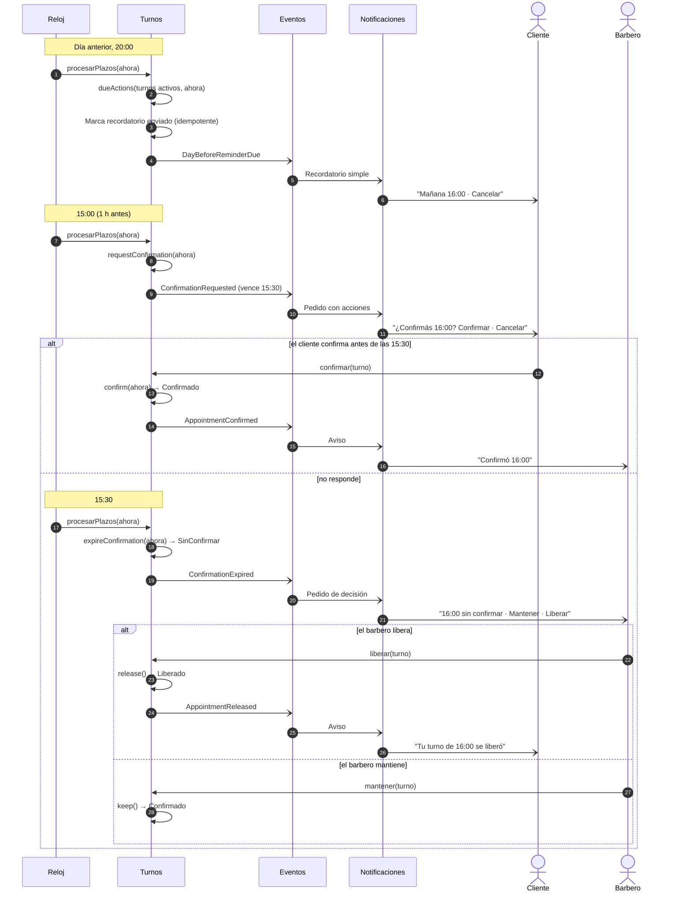
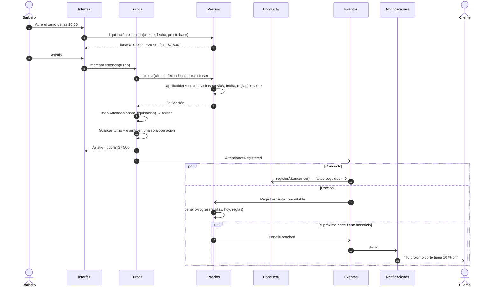
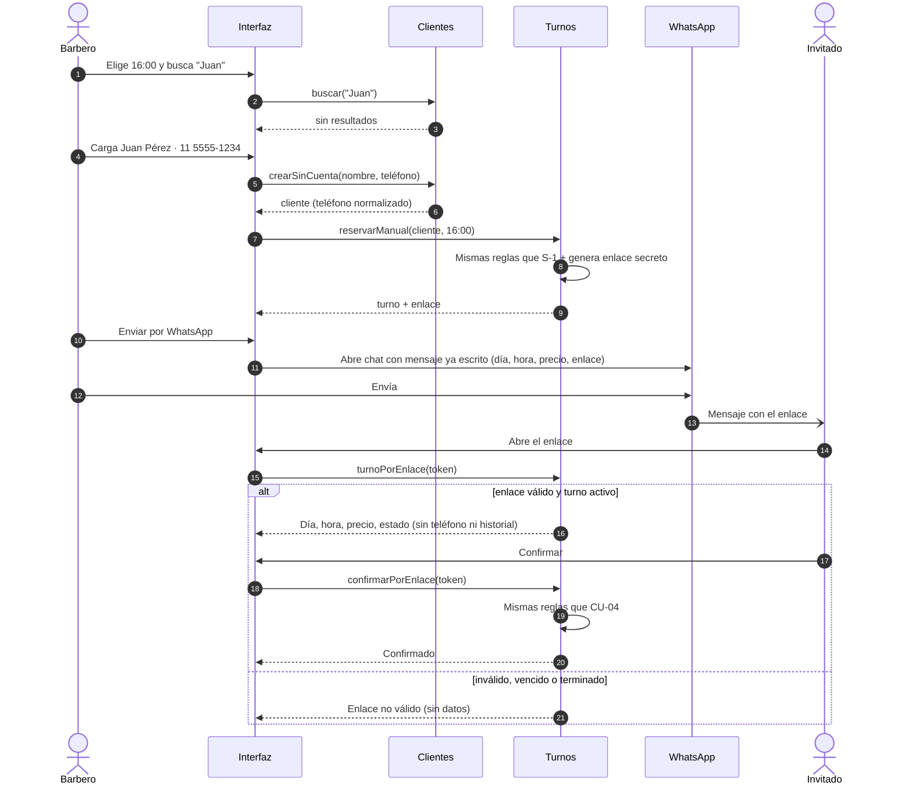

# Diagramas de secuencia — barber-colo

Estado: borrador (pendiente de aprobación)
Modelo: [`docs/dominio.md`](dominio.md) · Casos de uso: [`docs/casos-de-uso.md`](casos-de-uso.md)

> Muestran cómo colaboran los **módulos del dominio** en los cuatro flujos más delicados. Son
> independientes de la tecnología: "Interfaz" es la app del celular y "Eventos" es el mecanismo que
> registra cada evento junto con el cambio que lo produce y lo entrega después (dominio, sección 7).
>
> Convención: flecha llena `->>` = consulta o comando síncrono; flecha abierta `-)` = evento asíncrono.

---

## S-1. Reservar turno (CU-02, CU-03)

Lo crítico: dos clientes que reservan el mismo horario al mismo tiempo, y la habilitación del cliente.

**Por qué así:** la unicidad del horario (I-2) se garantiza en el momento de guardar, no en el paso 3.
Entre que el cliente ve el horario libre y lo reserva, otro puede haberlo tomado: el sistema lo detecta
al guardar y responde con un error claro, nunca con una doble reserva.

## S-2. Plazos: recordatorio, confirmación y vencimiento (CU-22, CU-04, CU-17)

Lo crítico: que cada acción ocurra **una sola vez** aunque el reloj se atrase o corra dos veces.

**Por qué así:** el reloj no decide nada; solo informa la hora. Las reglas de "qué corresponde ahora"
están en una función pura (`dueActions`) que se prueba con fechas fijas, incluidos los bordes exactos.
Cada turno guarda cuándo se envió su recordatorio y su pedido, así una segunda corrida no repite avisos.

## S-3. Registrar asistencia (CU-18)

Lo crítico: el precio final se calcula **una vez** y queda congelado, y los otros módulos se enteran
sin que Turnos dependa de ellos.

**Variante "Faltó":** en el paso 5 el barbero toca Faltó; no hay liquidación. `AttendanceRegistered`
viaja con `asistió = false`; Conducta suma una falta seguida y, si llega a 3, publica
`NoShowThresholdReached` para avisar al cliente de la política.

## S-4. Turno manual con enlace (CU-15, CU-09)

Lo crítico: que una persona sin cuenta pueda gestionar su turno sin exponer datos de nadie.

**Por qué así:** el enlace solo da acceso a **ese** turno y a dos acciones. Turnos no sabe qué es
WhatsApp: el mensaje lo arma la interfaz con los datos que devuelve Turnos.
